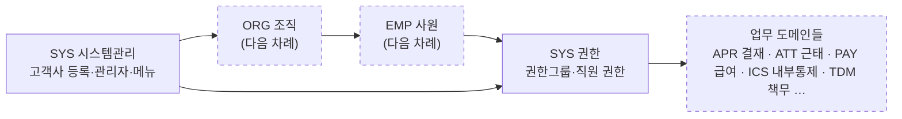

# 도메인Map — 도메인 사이 흐름

어느 화면이 비어 있으면 왼쪽(앞) 도메인의 이벤트가 아직 안 일어난 것이다. 도메인을 정리할 때마다 이 그림이 자란다.
지금은 SYS만 정리했다(2026-11-09). 점선 상자는 아직 정리하지 않은 도메인이다.

| 앞 도메인 | 없으면 생기는 일 |
|:---|:---|
| SYS 고객사 등록·사용여부 | 그 서브도메인으로 로그인이 안 된다 |
| SYS 회사 메뉴 | 로그인은 되는데 메뉴가 하나도 없다 |
| ORG 조직 · EMP 사원 | 사원정보 관리(#1029) 등 사원 화면이 "조회된 내용이 없습니다". 직원 로그인 불가 |
| SYS 권한(권한그룹·직원 연결) | 직원이 로그인해도 메뉴가 없다(기본권한 그룹이 없으면) |
