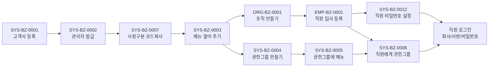

# 이벤트 대장 — 지나온 이벤트와 시나리오

변환은 화면 단위로 미리 정해져 있었지만, 비즈니스 이벤트는 **모르는 것을 찾아내며 진도를 나간다.** 그래서 이미 실행해 본 것은 ID와 이름을 여기에 고정해 두고, 아직 못 가 본 것은 [README 이벤트 목록](README.md)의 1차 목록(빈 상세)으로 둔다.

용어:

| 말 | 뜻 | ID |
|:---|:---|:---|
| **이벤트**(BizEvent) | 현실에서 일어나는 일 하나. 한 사람이 한 번에 하는 단위 | `{도메인}-BZ-{4자리}` (예: `SYS-BZ-0001`) |
| **시나리오** | 이벤트를 순서대로 이어 어떤 상태까지 가는 묶음 | `SNRO-{3자리}` (예: `SNRO-001`) |

ID는 한 번 붙이면 바꾸지 않고, 지운 번호는 다시 쓰지 않는다. 이름은 "~한다" 꼴 한 줄이다.

## 대장 — 실행해 본 이벤트 (2026-11-10 기준)

상태: `실행` = TOBE API로 가상 회사(kalpa·kova·igo)에서 돌려 봄 · `시험` = 자동 시험 있음 · `대기` = 화면 눈 확인 대기.

| ID | 이름 | 누가 | 상세 | 상태 |
|:---|:---|:---|:---|:---|
| SYS-BZ-0001 | 새 회사가 고객이 된다(고객사 등록) | KFS 관리자 | [상세](SYS/SYS-BZ-0001-고객사등록.md) | 실행·시험 |
| SYS-BZ-0002 | 고객사 관리자 계정을 발급한다 | KFS 관리자 | [상세](SYS/SYS-BZ-0002-고객사관리자발급.md) | 실행·시험 |
| SYS-BZ-0003 | 고객사가 쓸 메뉴를 열어 준다 | KFS 관리자 | [상세](SYS/SYS-BZ-0003-메뉴열어주기.md) | 실행·시험 |
| SYS-BZ-0007 | 고객사 공통코드를 갖춘다(사원구분 코드복사) | KFS 관리자 | [상세](SYS/SYS-BZ-0007-고객사공통코드.md) | 실행 |
| ORG-BZ-0001 | 본부·팀을 만든다(조직 입력) | 고객사 관리자 | [상세](ORG/ORG-BZ-0001-조직만들기.md) | 실행 |
| EMP-BZ-0001 | 직원을 입사 등록한다 | 고객사 관리자 | [상세](EMP/EMP-BZ-0001-직원입사등록.md) | 실행 |
| SYS-BZ-0012 | 직원 비밀번호를 설정·초기화한다 | 직원·고객사 관리자 | [상세](SYS/SYS-BZ-0012-직원비밀번호.md) | 실행(최초 설정) |
| SYS-BZ-0004 | 권한그룹을 만든다 | 고객사 관리자 | [상세](SYS/SYS-BZ-0004-권한그룹만들기.md) | 실행 |
| SYS-BZ-0005 | 권한그룹에 메뉴를 준다 | 고객사 관리자 | [상세](SYS/SYS-BZ-0005-권한그룹에메뉴주기.md) | 실행 |
| SYS-BZ-0006 | 직원에게 권한그룹을 준다 | 고객사 관리자 | [상세](SYS/SYS-BZ-0006-직원에게권한그룹주기.md) | 실행 |
| SYS-BZ-0008 | 영업일·휴일 달력을 정한다 | KFS 관리자 → 고객사 관리자 | [상세](SYS/SYS-BZ-0008-영업일휴일달력.md) | 실행 |
| SYS-BZ-0009 | 연차휴가 결산기준을 정한다 | 고객사 관리자 | [상세](SYS/SYS-BZ-0009-연차휴가결산기준.md) | 실행(API만) |
| SYS-BZ-0010 | 거래처(기관)를 등록한다 | KFS 관리자 → 고객사 관리자 | [상세](SYS/SYS-BZ-0010-거래처등록.md) | 실행 |
| SYS-BZ-0011 | 특정화면을 쓰겠다고 요청하고 KFS가 승인한다 | 과장 → 부장(결재) → KFS 관리자 | [상세](SYS/SYS-BZ-0011-특정화면사용요청.md) | 실행 |
| SYS-BZ-0013 | 개선사항·오류를 알리고 KFS가 처리한다 | 고객사 관리자 → KFS 관리자 | [상세](SYS/SYS-BZ-0013-개선사항오류통보.md) | 실행(API만) |
| SYS-BZ-0014 | 메뉴를 새로 만들거나 고친다(화면안내 포함) | KFS 관리자 | [상세](SYS/SYS-BZ-0014-메뉴만들기고치기.md) | 실행·화면 확인 |

(표 순서는 ID순이 아니라 **실행한 순서**다 — 아래 시나리오 SNRO-001과 같다.)

## 시나리오 대장

| ID | 이름 | 이벤트 순서 | 끝문 상태 | 만드는 도구 | 상태 |
|:---|:---|:---|:---|:---|:---|
| SNRO-001 | 회사 개설 | SYS-BZ-0001 → 0002 → 0007 → 0003 → ORG-BZ-0001 → EMP-BZ-0001 → SYS-BZ-0012 → SYS-BZ-0004 → 0005 → 0006 | 회사 admin·직원 7명이 로그인하고 직원마다 보이는 메뉴가 다르다 | `tools/create-virtual-company.sh` | kalpa·kova·igo 실행 |

(시나리오가 늘면 이 표에 한 줄씩 더한다. 한 이벤트는 여러 시나리오에 들어갈 수 있다.)

## 시나리오 상세

### SNRO-001 회사 개설 — "고객사가 생기고 직원이 로그인하는 데까지"

가상 회사 3곳(kalpa·kova·igo)이 모두 이 시나리오로 만들어졌다. `tools/create-virtual-company.sh <회사ID> "<회사명>" <사업자번호>`가 이 순서를 한 번에 돌린다.

| 단계 | 이벤트 | 누가 | 하는 일 |
|:---:|:---|:---|:---|
| 1 | SYS-BZ-0001 | KFS 관리자 | 회사 등록, 사용여부 켜기 |
| 2 | SYS-BZ-0002 | KFS 관리자 | 회사 관리자 `admin`/`1111` 발급 |
| 3 | SYS-BZ-0007 | KFS 관리자 | 사원구분 코드를 회사에 복사 |
| 4 | SYS-BZ-0003 | KFS 관리자 | 메뉴·권한그룹 복사(출발지 `prod_s1`) |
| 5 | ORG-BZ-0001 | 회사 관리자 | 본부 2개 |
| 6 | EMP-BZ-0001 | 회사 관리자 | 직원 7명(사번=직함) |
| 7 | SYS-BZ-0012 | 직원 | 비밀번호 `Kalpa1234!` 설정 |
| 8~10 | SYS-BZ-0004~0006 | 회사 관리자 | `임원` 권한그룹 → 메뉴 5개 → 사장·부장·과장 연결 |

**끝 상태:** 회사 `admin`/`1111`과 직원 `사번`/`Kalpa1234!`로 로그인하고, 직원마다 보이는 메뉴가 다르다(사원 12 · 사장·부장 15 · 과장 30).

## 아직 못 가 본 것

[README 이벤트 목록](README.md)의 SYS 0015~0021은 이름만 있는 1차 목록이다. 상세를 쓰고 실행해 보면 이 대장으로 옮긴다(이름이 바뀌면 ID는 두고 이름만 고친다).
