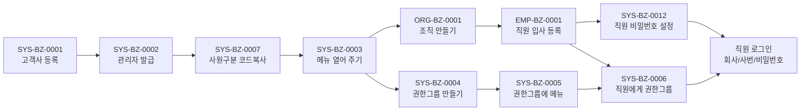

# 이벤트 대장 — 지나온 이벤트와 시나리오

변환은 화면 단위로 미리 정해져 있었지만, 비즈니스 이벤트는 **모르는 것을 찾아내며 진도를 나간다.** 그래서 이미 실행해 본 것은 ID와 이름을 여기에 고정해 두고, 아직 못 가 본 것은 [README 이벤트 목록](README.md)의 1차 목록(빈 상세)으로 둔다.

용어:

| 말 | 뜻 | ID |
|:---|:---|:---|
| **이벤트**(BizEvent) | 현실에서 일어나는 일 하나. 한 사람이 한 번에 하는 단위 | `{도메인}-BZ-{4자리}` (예: `SYS-BZ-0001`) |
| **시나리오** | 이벤트를 순서대로 이어 어떤 상태까지 가는 묶음 | `SNRO-{3자리}` (예: `SNRO-001`) |

ID는 한 번 붙이면 바꾸지 않고, 지운 번호는 다시 쓰지 않는다. 이름은 "~한다" 꼴 한 줄이다.

## 대장 — 실행해 본 이벤트 (2026-11-10 기준)

상태: `실행` = TOBE API로 가상 회사(kalpa·kova·igo)에서 돌려 봄 · `시험` = 자동 시험 있음 · `대기` = 화면 눈 확인 대기.

| ID | 이름 | 누가 | 상세 | 상태 |
|:---|:---|:---|:---|:---|
| SYS-BZ-0001 | 새 회사가 고객이 된다(고객사 등록) | KFS 관리자 | [상세](SYS/SYS-BZ-0001-고객사등록.md) | 실행·시험 |
| SYS-BZ-0002 | 고객사 관리자 계정을 발급한다 | KFS 관리자 | [상세](SYS/SYS-BZ-0002-고객사관리자발급.md) | 실행·시험 |
| SYS-BZ-0003 | 고객사가 쓸 메뉴를 열어 준다 | KFS 관리자 | [상세](SYS/SYS-BZ-0003-메뉴열어주기.md) | 실행·시험 |
| SYS-BZ-0007 | 고객사 공통코드를 갖춘다(사원구분 코드복사) | KFS 관리자 | [상세](SYS/SYS-BZ-0007-고객사공통코드.md) | 실행 |
| ORG-BZ-0001 | 본부·팀을 만든다(조직 입력) | 고객사 관리자 | [상세](ORG/ORG-BZ-0001-조직만들기.md) | 실행 |
| EMP-BZ-0001 | 직원을 입사 등록한다 | 고객사 관리자 | [상세](EMP/EMP-BZ-0001-직원입사등록.md) | 실행 |
| SYS-BZ-0012 | 직원 비밀번호를 설정·초기화한다 | 직원·고객사 관리자 | [상세](SYS/SYS-BZ-0012-직원비밀번호.md) | 실행(최초 설정) |
| SYS-BZ-0004 | 권한그룹을 만든다 | 고객사 관리자 | [상세](SYS/SYS-BZ-0004-권한그룹만들기.md) | 실행 |
| SYS-BZ-0005 | 권한그룹에 메뉴를 준다 | 고객사 관리자 | [상세](SYS/SYS-BZ-0005-권한그룹에메뉴주기.md) | 실행 |
| SYS-BZ-0006 | 직원에게 권한그룹을 준다 | 고객사 관리자 | [상세](SYS/SYS-BZ-0006-직원에게권한그룹주기.md) | 실행 |
| SYS-BZ-0008 | 영업일·휴일 달력을 정한다 | KFS 관리자 → 고객사 관리자 | [상세](SYS/SYS-BZ-0008-영업일휴일달력.md) | 실행 |
| SYS-BZ-0009 | 연차휴가 결산기준을 정한다 | 고객사 관리자 | [상세](SYS/SYS-BZ-0009-연차휴가결산기준.md) | 실행(API만) |
| SYS-BZ-0010 | 거래처(기관)를 등록한다 | KFS 관리자 → 고객사 관리자 | [상세](SYS/SYS-BZ-0010-거래처등록.md) | 실행 |
| SYS-BZ-0011 | 특정화면을 쓰겠다고 요청하고 KFS가 승인한다 | 과장 → 부장(결재) → KFS 관리자 | [상세](SYS/SYS-BZ-0011-특정화면사용요청.md) | 실행 |
| SYS-BZ-0013 | 개선사항·오류를 알리고 KFS가 처리한다 | 고객사 관리자 → KFS 관리자 | [상세](SYS/SYS-BZ-0013-개선사항오류통보.md) | 실행(API만) |
| SYS-BZ-0014 | 메뉴를 새로 만들거나 고친다(화면안내 포함) | KFS 관리자 | [상세](SYS/SYS-BZ-0014-메뉴만들기고치기.md) | 실행·화면 확인 |
| SYS-BZ-0015 | 시스템 공통코드를 관리한다 | KFS 관리자 | [상세](SYS/SYS-BZ-0015-시스템공통코드.md) | 실행·화면 확인 |
| SYS-BZ-0016 | KFS 관리자(Admin) 사용자 목록을 관리한다 | KFS 관리자 | [상세](SYS/SYS-BZ-0016-Admin사용자목록.md) | 실행 |
| SYS-BZ-0017 | 로그인 보안(공인IP·Mac 주소)을 정한다 | KFS 관리자 | [상세](SYS/SYS-BZ-0017-로그인보안.md) | 실행 |
| SYS-BZ-0018 | 파일보안정책(올릴 수 있는 확장자)을 정한다 | KFS 관리자 | [상세](SYS/SYS-BZ-0018-파일보안정책.md) | 실행·화면 확인 |
| SYS-BZ-0019 | 쓰지 않는 파일을 정리한다 | KFS 관리자 | [상세](SYS/SYS-BZ-0019-미사용파일정리.md) | 실행 |
| SYS-BZ-0020 | 매뉴얼·자문위원·관리팀 안내를 올린다 | KFS 관리자 | [상세](SYS/SYS-BZ-0020-매뉴얼자문위원관리팀.md) | 실행 |
| SYS-BZ-0021 | 접속자에게 로그아웃 알림을 보낸다(배포 전) | KFS 관리자 | [상세](SYS/SYS-BZ-0021-로그아웃알림.md) | 실행 |
| SYS-BZ-0022 | 고객사에 결재 문서 양식을 복사해 준다 | KFS 관리자 | [상세](SYS/SYS-BZ-0022-문서양식복사.md) | 실행 |
| ORG-BZ-0002 | 조직 이름·레벨·정보를 바꾼다(변경 이력) | 고객사 관리자 | [상세](ORG/ORG-BZ-0002-조직정보바꾸기.md) | 실행 |
| ORG-BZ-0003 | 조직을 다른 상위 조직 밑으로 옮긴다(조직개편) | 고객사 관리자 | [상세](ORG/ORG-BZ-0003-상위조직이동.md) | 실행 |
| ORG-BZ-0004 | 조직을 폐쇄한다 | 고객사 관리자 | [상세](ORG/ORG-BZ-0004-조직폐쇄.md) | 실행 |
| ORG-BZ-0005 | 잘못 만든 조직·이력을 지운다 | 고객사 관리자 | [상세](ORG/ORG-BZ-0005-조직이력삭제.md) | 실행 |
| EMP-BZ-0002 | 직원을 발령한다(이동·승진·승급) | 고객사 관리자 | [상세](EMP/EMP-BZ-0002-발령.md) | 실행 |
| EMP-BZ-0003 | 직원에게 겸직을 발령한다 | 고객사 관리자 | [상세](EMP/EMP-BZ-0003-겸직발령.md) | 실행 |
| EMP-BZ-0004 | 직원을 퇴직 처리한다 | 고객사 관리자 | [상세](EMP/EMP-BZ-0004-퇴직.md) | 실행 |
| EMP-BZ-0005 | 잘못 등록한 사원을 지운다 | 고객사 관리자 | [상세](EMP/EMP-BZ-0005-사원삭제.md) | 실행 |
| EMP-BZ-0006 | 직원의 인사기록을 채운다(학력·가족·경력 등) | 고객사 관리자 | [상세](EMP/EMP-BZ-0006-인사기록채우기.md) | 실행 |
| EMP-BZ-0007 | 특정직위와 알림 대상을 정한다 | 고객사 관리자 | [상세](EMP/EMP-BZ-0007-특정직위알림.md) | 실행 |
| EMP-BZ-0008 | 임원 정보를 관리한다 | 고객사 관리자 | [상세](EMP/EMP-BZ-0008-임원정보관리.md) | 실행 |
| EMP-BZ-0009 | 직원의 급여공제 정보를 정한다 | 고객사 관리자 | [상세](EMP/EMP-BZ-0009-급여공제정보.md) | 실행(API) |
| EMP-BZ-0010 | 직원이 결재 서명을 등록한다 | 직원 | [상세](EMP/EMP-BZ-0010-결재서명.md) | 실행(API) |
| EMP-BZ-0011 | 결재선 예외 대상을 정한다 | 고객사 관리자 | [상세](EMP/EMP-BZ-0011-결재선예외.md) | 실행(API) |
| EMP-BZ-0012 | 주소록을 관리한다(개인·공용·그룹) | 직원 | [상세](EMP/EMP-BZ-0012-주소록.md) | 실행 |
| EMP-BZ-0013 | 증명서를 발급한다(재직·경력·징계내역) | 과장 → 부장(결재) | [상세](EMP/EMP-BZ-0013-증명서발급.md) | 실행 |
| EMP-BZ-0014 | 휴가를 신청하고 결재받는다 | 사원 → 과장(결재) | [상세](EMP/EMP-BZ-0014-휴가신청결재.md) | 실행 |
| EMP-BZ-0015 | 연차 사용촉진(1차) → 직원 사용시기 지정 → 회사 지정통보(2차) | 과장 → 사원 → 과장(결재) | [상세](EMP/EMP-BZ-0015-연차사용촉진지정통보.md) | 실행(API, 집 DB) |
| EMP-BZ-0016 | 회사가 모두 쉬는 날(공동연차)을 정한다 | 과장 → 결재자 | [상세](EMP/EMP-BZ-0016-공동연차.md) | 실행(API) |
| EMP-BZ-0017 | 회사가 직원에게 포상휴가를 준다 | 과장 → 결재자 → 직원 | [상세](EMP/EMP-BZ-0017-포상휴가.md) | 실행(API) |
| EMP-BZ-0018 | 외출을 등록한다 | 직원 → 경영관리팀 | [상세](EMP/EMP-BZ-0018-외출등록.md) | 실행(API) |
| EMP-BZ-0019 | 출장을 품의하고 결과를 보고한다 | 직원 → 결재자 | [상세](EMP/EMP-BZ-0019-출장품의결과보고.md) | 실행(API) |
| EMP-BZ-0020 | 여비교통비를 신청·마감하고 지출결의한다 | 직원 → 경영관리팀 → 결재자 | [상세](EMP/EMP-BZ-0020-여비교통비.md) | 실행(API) |
| EMP-BZ-0021 | 복리후생비 코드를 정한다 | KFS 관리자 | [상세](EMP/EMP-BZ-0021-복리후생비코드.md) | 실행(API) |
| EMP-BZ-0022 | 복리후생비를 신청하고 지급한다 | 직원 → 팀장 → 경영관리팀 | [상세](EMP/EMP-BZ-0022-복리후생비신청관리.md) | 실행(API) |
| EMP-BZ-0023 | 인사평가 항목을 정한다 | 과장 | [상세](EMP/EMP-BZ-0023-인사평가항목.md) | 실행(API) |
| EMP-BZ-0024 | 인사평가를 진행한다 | 과장 → 평가자 → 대표이사 | [상세](EMP/EMP-BZ-0024-인사평가진행.md) | 실행(API) |
| APR-BZ-0001 | 결재문서를 기안해 상신한다 | 직원·결재자 | [상세](APR/APR-BZ-0001-기안상신.md) | 실행(API) |
| APR-BZ-0002 | 결재자가 승인·반려한다 | 직원·결재자 | [상세](APR/APR-BZ-0002-승인반려.md) | 실행(API) |
| APR-BZ-0003 | 문서를 회수·재상신·폐기한다 | 직원·결재자 | [상세](APR/APR-BZ-0003-회수재상신폐기.md) | 실행(API) |
| APR-BZ-0004 | 문서함에서 찾고 인쇄·공람 지정한다 | 직원·결재자 | [상세](APR/APR-BZ-0004-문서함조회인쇄.md) | 실행(API) |
| APR-BZ-0005 | 대결자를 지정한다 | 직원·결재자 | [상세](APR/APR-BZ-0005-대결자지정.md) | 실행(API) |
| APR-BZ-0006 | 결재선 그룹을 만든다 | 직원·결재자 | [상세](APR/APR-BZ-0006-결재선그룹.md) | 실행(API) |
| APR-BZ-0007 | 사용인감·대표명의를 등록한다 | 직원·결재자 | [상세](APR/APR-BZ-0007-사용인감대표명의.md) | 실행(API) |
| APR-BZ-0008 | 법인서류·인감날인을 신청·관리한다 | 직원·결재자 | [상세](APR/APR-BZ-0008-법인서류날인.md) | 실행(API) |
| APR-BZ-0009 | 폐기문서를 승인하고 복구한다 | 직원·경영관리 | [상세](APR/APR-BZ-0009-폐기문서승인복구.md) | 실행(API) |
| APR-BZ-0010 | 구)법인서류·날인을 처리한다 | 직원·경영관리 | [상세](APR/APR-BZ-0010-구법인서류날인.md) | 실행(API) |
| APR-BZ-0011 | 대외활동 신청서·이익제공 사전승인을 올린다 | 직원·경영관리 | [상세](APR/APR-BZ-0011-대외활동이익제공신청.md) | 실행(API) |
| APR-BZ-0012 | 문서를 검색하고 작성현황을 본다 | 직원·경영관리 | [상세](APR/APR-BZ-0012-문서검색작성현황.md) | 실행(API) |
| ATT-BZ-0001 | 회사가 근태관리를 켜고 근태정책을 정한다 | KFS 관리자 → 경영관리팀 | [상세](ATT/ATT-BZ-0001-근태정책설정.md) | 실행(API) |
| ATT-BZ-0002 | 직원이 출근·퇴근을 기록한다 | 직원 | [상세](ATT/ATT-BZ-0002-출퇴근기록.md) | 실행(API) |
| ATT-BZ-0003 | 연장·야간근무를 신청하고 결재받는다 | 직원 → 팀장 | [상세](ATT/ATT-BZ-0003-연장근무신청결재.md) | 실행(API) |
| ATT-BZ-0004 | 오후근무를 신청하고 결재받는다 | 직원 → 팀장 | [상세](ATT/ATT-BZ-0004-오후근무신청결재.md) | 실행(API) |
| ATT-BZ-0005 | 경영관리팀이 근태를 관리한다 | 경영관리팀 | [상세](ATT/ATT-BZ-0005-근태관리관리자.md) | 실행(API) |
| ATT-BZ-0006 | 결재 끝난 연장근무를 확정한다 | 경영관리팀 | [상세](ATT/ATT-BZ-0006-연장근무확정.md) | 실행(API) |
| ATT-BZ-0007 | 근태현황을 본다 | 경영관리·직원 | [상세](ATT/ATT-BZ-0007-근태현황조회.md) | 실행(API) |
| PAY-BZ-0001 | 근로시간 기준을 정한다 | KFS 관리자 | [상세](PAY/PAY-BZ-0001-근로시간기준.md) | 실행(API) |
| PAY-BZ-0002 | 급여 기초정보를 갖춘다 | KFS 관리자 → 경영관리팀 | [상세](PAY/PAY-BZ-0002-급여기초정보.md) | 실행(API) |
| PAY-BZ-0003 | 직원과 연봉계약을 맺는다 | 경영관리팀 → 결재자 → 직원 | [상세](PAY/PAY-BZ-0003-연봉계약.md) | 실행(API) |
| PAY-BZ-0004 | 월 급여를 계산하고 확정한다 | 경영관리팀 → 결재자 | [상세](PAY/PAY-BZ-0004-월급여계산확정.md) | 실행(API) |
| PAY-BZ-0005 | 급여대장·급여명세서를 본다 | 경영관리팀·직원 | [상세](PAY/PAY-BZ-0005-급여대장명세서.md) | 실행(API) |
| PAY-BZ-0006 | 퇴직자를 정산한다 | 경영관리팀 → 결재자 | [상세](PAY/PAY-BZ-0006-퇴직정산.md) | 실행(API) |
| PAY-BZ-0007 | 4대보험을 신고하고 정산한다 | 경영관리팀 | [상세](PAY/PAY-BZ-0007-4대보험신고정산.md) | 실행(API) |
| PAY-BZ-0008 | 원천징수영수증·갑근세확인서 | 경영관리팀 → 직원 / 결재자 | [상세](PAY/PAY-BZ-0008-원천징수영수증갑근세확인서.md) | 실행(API) |
| PAY-BZ-0009 | 사업비 지출요청·부서장 승인 | 직원 → 부서장 | [상세](PAY/PAY-BZ-0009-사업비지출요청승인.md) | 실행(API) |
| PAY-BZ-0010 | 지출결의서 | 경영관리 → 결재자 | [상세](PAY/PAY-BZ-0010-지출결의서.md) | 실행(API) |
| PAY-BZ-0011 | 자금집행결의서 | 자금관리 → 결재자 | [상세](PAY/PAY-BZ-0011-자금집행결의서.md) | 실행(API) |
| PAY-BZ-0012 | 사업비 회계처리·미지급반제 | 자금관리 | [상세](PAY/PAY-BZ-0012-사업비회계처리미지급반제.md) | 실행(API, 반제는 AST-BZ-0003) |
| AST-BZ-0001 | 거래유형·화면별 거래유형 기초 | KFS 관리자 | [상세](AST/AST-BZ-0001-거래유형기초.md) | 실행(API) |
| AST-BZ-0002 | 고유자산 분류·예금계좌 등록 | 회사 관리자 → 자금관리 | [상세](AST/AST-BZ-0002-고유자산분류계좌등록.md) | 실행(API) |
| AST-BZ-0003 | 미지급 결제등록(반제) | 자금관리 | [상세](AST/AST-BZ-0003-미지급결제등록.md) | 실행(API) |
| AST-BZ-0006 | 계좌이체·예금 이자수령 | 자금관리 | [상세](AST/AST-BZ-0006-계좌이체이자수령.md) | 실행(API) |
| AST-BZ-0004 | 예금잔고 정리·조회·대사 | 자금관리 | [상세](AST/AST-BZ-0004-예금잔고정리조회대사.md) | 실행(API, 상신 대기) |
| AST-BZ-0005 | 원천세·4대보험 납부 | 자금관리 | [상세](AST/AST-BZ-0005-세금4대보험납부.md) | 실행(API, 결재요청 대기) |
| AST-BZ-0007 | 고유자산 거래·미수/미지급 결제 | 회계·자금관리 | [상세](AST/AST-BZ-0007-고유자산거래미수미지급.md) | 실행(API) |
| AST-BZ-0008 | 금융상품 매수·매도·보유 | 운용 | [상세](AST/AST-BZ-0008-금융상품매매보유.md) | 실행(API) |
| AST-BZ-0009 | 금융상품 시세·평가 | 운용·회계 | [상세](AST/AST-BZ-0009-금융상품시세평가.md) | 실행(API) |
| AST-BZ-0010 | 공모주 청약·환불·입고 | 운용 | [상세](AST/AST-BZ-0010-공모주청약.md) | 실행(API) |
| AST-BZ-0011 | 비품 구입·감가상각 | 경영관리 | [상세](AST/AST-BZ-0011-비품구입감가상각.md) | 실행(API) |
| AST-BZ-0012 | 자기자본·투자한도 등록 | 경영관리 | [상세](AST/AST-BZ-0012-자기자본투자한도.md) | 실행(API) |
| AST-BZ-0013 | 외화 거래·환평가 | 경영관리 | [상세](AST/AST-BZ-0013-외화거래환평가.md) | 실행(API) |
| AST-BZ-0014 | 펀드 운용보수 결산·이관 | 경영관리 | [상세](AST/AST-BZ-0014-펀드보수결산.md) | 실행(API, 운용보수만) |
| AST-BZ-0015 | 선급금·선급비용 | 경영관리 | [상세](AST/AST-BZ-0015-선급금선급비용.md) | 실행(API) |
| ICS-BZ-0001 | 법규 관리그룹 | 준법감시 담당 | [상세](ICS/ICS-BZ-0001-법규관리그룹.md) | 실행(API) |
| ICS-BZ-0002 | 법규 관리·그룹 지정 | 준법감시 담당 | [상세](ICS/ICS-BZ-0002-법규관리.md) | 실행(API) |
| ICS-BZ-0003 | 체크리스트 작성·확인 | 담당자·확인자 | [상세](ICS/ICS-BZ-0003-체크리스트작성확인.md) | 실행(API) |
| ICS-BZ-0004 | 준수확인서 작성·점검·보고 | 임직원·준법감시인 | [상세](ICS/ICS-BZ-0004-준수확인서.md) | 실행(API) |
| ICS-BZ-0005 | 대외활동 신청·결재 | 임직원 | [상세](ICS/ICS-BZ-0005-대외활동신청.md) | 실행(API) |
| ICS-BZ-0006 | 법규등록신청 | 임직원·KFS | [상세](ICS/ICS-BZ-0006-법규등록신청.md) | 실행(API) |
| ICS-BZ-0007 | 법규 개정내역 | KFS·임직원 | [상세](ICS/ICS-BZ-0007-법규개정내역.md) | 실행(API) |
| ICS-BZ-0008 | 법규보고 서식파일 | KFS·임직원 | [상세](ICS/ICS-BZ-0008-법규보고서식파일.md) | 실행(API) |
| ICS-BZ-0009 | 준감인 사전확인대장 | 준법감시인·직원 | [상세](ICS/ICS-BZ-0009-준감인사전확인대장.md) | 실행(API) |
| ICS-BZ-0010 | 법규별 문서작성 | 임직원 | [상세](ICS/ICS-BZ-0010-법규별문서작성.md) | 실행(API) |
| ICS-BZ-0011 | 법규 마스터 관리 | KFS | [상세](ICS/ICS-BZ-0011-법규마스터관리.md) | 실행(API) |
| ICS-BZ-0012 | 공통 체크리스트 관리 | KFS | [상세](ICS/ICS-BZ-0012-체크리스트마스터.md) | 실행(API) |
| ICS-BZ-0013 | 준수리스트 개정·확정 | 준법감시인 | [상세](ICS/ICS-BZ-0013-준수리스트개정확정.md) | 실행(API) |
| ICS-BZ-0014 | 법규·대외활동 현황 조회 | 임직원 | [상세](ICS/ICS-BZ-0014-법규대외활동현황조회.md) | 실행(조회 API) |
| ICS-BZ-0015 | 법규 서식파일 연결 | KFS | [상세](ICS/ICS-BZ-0015-법규첨부서식연결.md) | 실행(API) |
| ICS-BZ-0016 | 법규-책무점검항목 연결 | KFS | [상세](ICS/ICS-BZ-0016-법규책무연결.md) | 실행(API) |
| ICS-BZ-0017 | 체크리스트 결재 상신(A27) | 확인자·결재자 | [상세](ICS/ICS-BZ-0017-체크리스트결재상신.md) | 실행(API) |
| ICS-BZ-0018 | 준수보고 결재 상신(A32) | 준법감시인·결재자 | [상세](ICS/ICS-BZ-0018-준수보고결재상신.md) | 실행(API) |
| ICS-BZ-0019 | 법규보고 점검 처리 | 담당 부서 직원 | [상세](ICS/ICS-BZ-0019-법규보고점검처리.md) | 실행(API) |
| ICS-BZ-0020 | 법규보고 점검 확인 | 부서장 | [상세](ICS/ICS-BZ-0020-법규보고점검확인.md) | 실행(API) |
| ICS-BZ-0021 | 체크리스트 현황·자체 항목·법규 연결 | 준법감시인 | [상세](ICS/ICS-BZ-0021-체크리스트현황자체항목.md) | 실행(API) |
| ICS-BZ-0022 | 대외활동 결과보고(B16) | 임직원·결재자 | [상세](ICS/ICS-BZ-0022-대외활동결과보고.md) | 실행(API) |
| TDM-BZ-0001 | 책무 설정·임원 등록 | 책무 담당 | [상세](TDM/TDM-BZ-0001-설정과임원.md) | 실행(API) |
| TDM-BZ-0002 | 책무·직책·회의체 | 책무 담당 | [상세](TDM/TDM-BZ-0002-책무직책회의체.md) | 실행(API, 첫 직책 DB) |
| TDM-BZ-0003 | 담당자·승인선 | 책무 담당 | [상세](TDM/TDM-BZ-0003-담당자승인선.md) | 실행(API) |
| TDM-BZ-0004 | 임원 직책배정·동의서 | 책무 담당·결재자 | [상세](TDM/TDM-BZ-0004-임원직책배정.md) | 실행(API) |
| TDM-BZ-0005 | 기술서·체계도·구조도 제출 | 책무 담당 | [상세](TDM/TDM-BZ-0005-책무기술서체계도구조도.md) | 실행(API) |
| TDM-BZ-0006 | 부서책무매뉴얼 | 책무 담당 | [상세](TDM/TDM-BZ-0006-부서책무매뉴얼.md) | 실행(API) |
| TDM-BZ-0007 | 책무이행점검 | 책무 담당·점검자·책무임원 | [상세](TDM/TDM-BZ-0007-책무이행점검.md) | 실행(API) |
| TDM-BZ-0008 | 책무 대시보드 | 책무 담당·임원 | [상세](TDM/TDM-BZ-0008-책무대시보드.md) | 실행(조회 API) |
| BIZ-BZ-0001 | 이익제공 한도기준·직원 자동등록 | 준법감시인 | [상세](BIZ/BIZ-BZ-0001-이익제공한도기준관리.md) | 실행(API) |
| BIZ-BZ-0002 | 법인카드 이익제공 입력·상신(A41) | 직원·결재자 | [상세](BIZ/BIZ-BZ-0002-법인카드이익제공입력상신.md) | 실행(API) |
| BIZ-BZ-0003 | 현금·물품 이익제공(수령) 입력 | 직원 | [상세](BIZ/BIZ-BZ-0003-현금물품이익제공입력.md) | 실행(API) |
| BIZ-BZ-0004 | 법인카드 사용내역 조회 | 준법감시인 | [상세](BIZ/BIZ-BZ-0004-법인카드사용내역조회.md) | 실행(조회 API) |

(표 순서는 ID순이 아니라 **실행한 순서**다 — 아래 시나리오 SNRO-001과 같다.)

## 시나리오 대장

| ID | 이름 | 이벤트 순서 | 끝문 상태 | 만드는 도구 | 상태 |
|:---|:---|:---|:---|:---|:---|
| SNRO-001 | 회사 개설 | SYS-BZ-0001 → 0002 → 0007 → 0003 → ORG-BZ-0001 → EMP-BZ-0001 → SYS-BZ-0012 → SYS-BZ-0004 → 0005 → 0006 | 회사 admin·직원 7명이 로그인하고 직원마다 보이는 메뉴가 다르다 | `tools/create-virtual-company.sh` | kalpa·kova·igo 실행 |

(시나리오가 늘면 이 표에 한 줄씩 더한다. 한 이벤트는 여러 시나리오에 들어갈 수 있다.)

## 시나리오 상세

### SNRO-001 회사 개설 — "고객사가 생기고 직원이 로그인하는 데까지"

가상 회사 3곳(kalpa·kova·igo)이 모두 이 시나리오로 만들어졌다. `tools/create-virtual-company.sh <회사ID> "<회사명>" <사업자번호>`가 이 순서를 한 번에 돌린다.

| 단계 | 이벤트 | 누가 | 하는 일 |
|:---:|:---|:---|:---|
| 1 | SYS-BZ-0001 | KFS 관리자 | 회사 등록, 사용여부 켜기 |
| 2 | SYS-BZ-0002 | KFS 관리자 | 회사 관리자 `admin`/`1111` 발급 |
| 3 | SYS-BZ-0007 | KFS 관리자 | 사원구분 코드를 회사에 복사 |
| 4 | SYS-BZ-0003 | KFS 관리자 | 메뉴·권한그룹 복사(출발지 `prod_s1`) |
| 5 | ORG-BZ-0001 | 회사 관리자 | 본부 2개 |
| 6 | EMP-BZ-0001 | 회사 관리자 | 직원 7명(사번=직함) |
| 7 | SYS-BZ-0012 | 직원 | 비밀번호 `Kalpa1234!` 설정 |
| 8~10 | SYS-BZ-0004~0006 | 회사 관리자 | `임원` 권한그룹 → 메뉴 5개 → 사장·부장·과장 연결 |

**끝 상태:** 회사 `admin`/`1111`과 직원 `사번`/`Kalpa1234!`로 로그인하고, 직원마다 보이는 메뉴가 다르다(사원 12 · 사장·부장 15 · 과장 30).

## 아직 못 가 본 것

SYS 1차 목록(0001~0021)은 모두 상세를 쓰고 실행해 이 대장에 옮겼다(2026-11-10). 새 SYS 이벤트가 생기면 0022부터 쓴다.

ORG 1차 목록(0001~0005)도 실행했다(2026-11-10, 0002~0005는 kalpa에 시험 팀을 만들어 돌린 뒤 지움). 새 ORG 이벤트는 0006부터.

EMP는 인사(0001~0005)를 실행했다(2026-11-10, 0002~0005는 시험 사원 `499`로 돌린 뒤 삭제. 주인 없는 행 `emp02_others` 1 · `emp03_trans` 2 · `emp35_deduct` 1이 kalpa에 남음 — 원본도 사원 삭제 때 이 행들을 지우지 않는다). 0006~0008도 실행했다(401·202·100 사원에 값을 넣었다 되돌림, 남은 것: `emp25_mypage_notice` 정부장 1행, `emp31_director` 김사장 1행(빈 값)). 0009~0011도 API로 실행했다(값 되돌림, 남은 것 없음). kalpa에는 이 메뉴들이 없다. 2026-11-10 kalpa에 EMP 업무 메뉴 29개를 열었다(KFS #1076 + #1070, [EMP 흐름도](EMP/EMP-업무흐름.md#가상-회사-kalpa의-메뉴-범위)). 0012·0013도 실행했다(0013 김사원 재직증명서 결재 완료 1건은 남겨 둠). 0014도 실행했다(김사원 연차 2026-11-16~17 결재 완료 1건과 kalpa `dcr30_link` 93행·A01 지정, SYS-BZ-0022로 복사한 양식 `com10_form_mapping` 5행은 남겨 둠). 0015도 실행했다(2026-11-10 저녁 집 DB — 11-09 상태라 SYS-BZ-0008 달력을 다시 만들고, 1차 01 행 7개는 7월 창 대신 DB에 직접 넣음. 01 통지서 7·김사원 지정통보서 1·02 행 6·02 통지서 6건은 남겨 둠. 같은 저녁 서명(0010)·회사 인감·인감 증명서(0013 발급번호 1)·김사원 사진(0006)도 남겨 둠). 0016~0024는 [README](README.md) 1차 목록. 휴가·출장·비용(0014~0022)은 APR 결재와 함께 해야 한다.

ATT(근태) 0001~0007을 실행했다(2026-11-12, kalpa, API — 근태 메뉴 없음). 바꾼 설정: kalpa `sys01_commute_popup_yn=true`, `dcr30_link` A73·A74 → `인사/인사관리/근태관리`, 근태정책 1줄(2026-11-01). 남겨 둔 것: 401·402 출퇴근 11-02~06·11-12(12줄)와 보정 이력 4줄, 연장근무 1줄(401 11-12 완료), 오후근무 1줄(402 11-16 완료), 결재문서 2건(A74 `202611129140071`, A73 `202611129140095`). 시험으로 생긴 타사 사원 근태 1줄(#63)·위조 연장근무 1줄과 `att13` 1줄(#66)·402 자기 보정 이력 1줄(#62)은 2026-11-12 사용자가 SQL로 지웠다. 직원 비밀번호는 `1111`(2026-11-12 규칙 변경).

PAY(급여·사업비) 0001~0012를 실행했다(2026-11-12, kalpa, API — PAY 메뉴 없음). 바꾼 것: kalpa 임금계산방법 `2023-04-01` 6줄(KFS 기초데이터생성), `dcr30_link` D01 → 연봉계약서, 연봉계약 2줄(401 결재 완료 `202611129140116`, 402 미상신 `202611129140120`). 근로시간 기준 시험 줄은 지웠다. 0004: 급여(01) 지급일 2026-11-25 401·402(`pay10_month` +2, 항목 14), 급여출금계좌 1줄, `dcr30_link` A02 → 급여 > 급여, 급여대장 상신 행 `202611129140146`·결재 완료 `202611129140153`(첫 문서 `…148`은 반려). 0005는 조회만. 0006: 시험 직원 `403 이퇴직`(입사 2024-03-04·퇴직 2026-11-20, 연봉 D01 완료 `202611129140179`), 퇴직정산 급여 `202611129140183`, A05 → 퇴직정산, 퇴직정산 결재 완료 `202611129140205`(상신 행 `202611129140245`). 0007: 401 4대보험 신고 7줄(취득 3·보수총액 2026 2·보수변동 2027.01 2), 정산 `pay32` 3줄(고용 2회 분할), 401 2026-12-24 급여(미상신, 국민연금 NULL). 0008: 401 원천징수영수증 1건(`pay08` `202611129140304`, 파일 `…305`), X01 → 증명서, 401 갑근세확인서 결재 완료 `202611129140315`. 0009: 401 사업비 요청 `202611129140325`(55,000원, 301 승인 20). 0010: A63 → 사업비 지출결의서, 그 요청의 결의자 301·지출결의서 결재 완료 `202611129140332`. 0011: A64 → 자금집행결의서, 급여(김사원) 지출 행 `202611129140343` + 다과 집행일 2026-11-25, 자금집행결의서 완료 `202611129140344`. 0012: KFS [기초데이터생성]으로 kalpa 회계 기초(대표계정 65·실계정맵 214·분개맵핑 82/181), 다과 계정과목 회의비·전표 `202611129140980`(번호 261112001). 미지급반제는 AST-BZ-0003에서 했다.

AST(고유자산·자금) 0001~0011을 실행했다(2026-11-12, kalpa, API — AST 메뉴 없음). 바꾼 것: kalpa 거래유형 `ast05` 89줄(KFS 기초데이터생성)·화면별 거래유형 `ast15` 44줄, 고유자산 분류 `ast01` 176줄·담당 부서 `ast10` 414줄(회사 0에서 가져오기), 계좌 `우리은행 1002-555-000111(칼파 운영)` `202611129141714`. PAY-BZ-0011 집행 줄 2개(다과·급여)에 출금계좌·집행일 2026-11-25, 다과 미지급 결제 `ast07` `202611129141717`·전표 `202611129141718`. 사원 시험 행(`ZZ사원시험계좌`·`Zz_Test`)은 지웠다. 0006: 이체 `202611129141725`(신한은행#011 → 우리은행 5,000,000)·이자 `202611129141751`(12,000, 실수령 10,160)과 전표 2건. 0004: 예금잔고 정리(2026-11-12~), 실제 잔액 `ast12` 2줄(ID `202611129999001`·`…002`를 손으로 줌 — 의심 #108). 0005: kalpa `ast15` `Ast06_Tab_TrTax` 3줄(KFS), 원천세 납부 `202611129141780`(165,000)·4대보험 납부 `202611129141790`(565,200, 분개 계정 빈칸 4줄 — 의심 #110). 0007: 통신비 미지급 `202611129141836`(110,000)·결제 `202611129141845`. 0008: 수익증권 매수 `202611129141854`(1,000,000)·매도 `202611129141865`(400,000좌 → 420,000). 0009: 시세 `ast25` `202611129141877`(1,080), 평가 `202611129141879`·평가반제 `202611129141885`(648,000). 0010: kalpa `ast15` `Ast06_Tab_TrIPO` 7줄(KFS), 공모주12 청약 `202611129141920`·환불 `…928`·입고 `…934`(50주). 0011: 노트북 구입 `202611129141949`(2,200,000), 감가상각 10-31 `202611129141964`·11-30(각 33,333).
