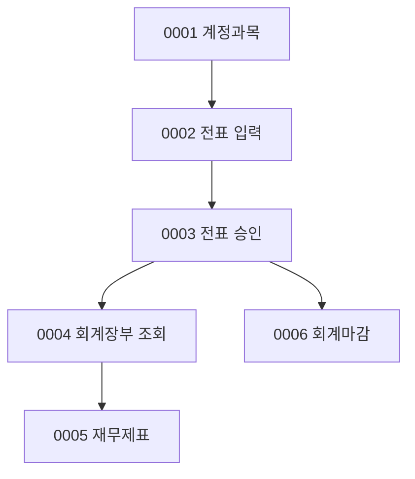

# ACT 업무흐름 — 관리회계 

메뉴 `관리회계`(37개) 중 자산·자금 쪽(고유자산 거래·계좌이체·외화·예금대사·펀드보수 결산)은 AST·PAY·CRD 이벤트가 이미 다뤘다. ACT는 **계정과목 → 전표 → 장부 → 재무제표 → 마감**의 회계 본체를 다룬다. ICAM 펀드보수 화면(#1199·#1200·#1204·#1214·#1215·#1217·#1494)은 ICAM 연동이 없어 뺐다(보안_및_버그_의심 #179).

| ID | 사건 | 주요 화면 | 상태 |
|:---|:---|:---|:---|
| ACT-BZ-0001 | 계정과목을 관리한다 | #1250 | 실행 |
| ACT-BZ-0002 | 전표를 직접 입력·수정·삭제한다(원화·외화) | #1148, #1176 | 실행(원화) |
| ACT-BZ-0003 | 전표를 승인(확정)한다 | #1207 | 실행 |
| ACT-BZ-0004 | 회계장부(분개장·계정별원장·계정과목집계표)를 본다 | #1149, #1177, #1150, #1151 | 실행(외화 제외) |
| ACT-BZ-0005 | 재무제표(손익·재무상태·금감원보고용)를 본다 | #1178, #1179, #1225 | 실행 |
| ACT-BZ-0006 | 회계를 마감한다 | #1195 | 실행 |

## 화면번호 → 이벤트

| 화면 | 이벤트 |
|:---|:---|
| #1250 계정과목 관리 | 0001 |
| #1148 전표입력 | 0002 |
| #1207 전표승인처리 | 0003 |
| #1149 분개장 · #1150 계정별원장 · #1151 계정과목집계표 | 0004 |
| #1178 손익계산서 · #1179 재무상태표 · #1225 금감원보고용 재무제표 | 0005 |
| #1195 회계마감 · #1368 마감검증 체크항목 | 0006 |
