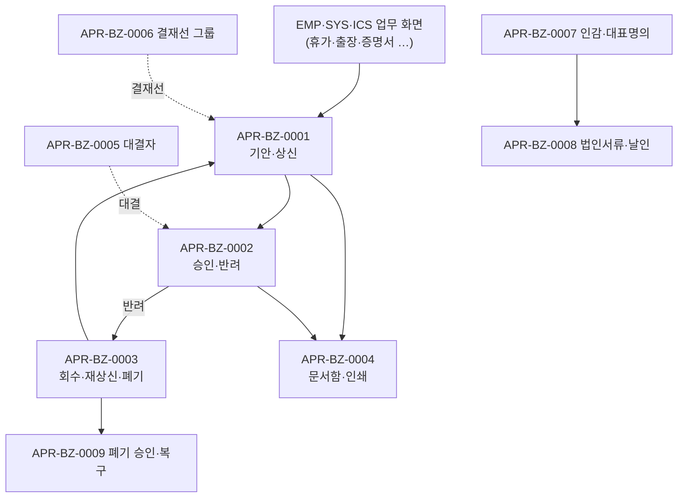

# APR 업무흐름 — 전자결재

결재문서는 **업무 화면(휴가·출장·증명서 등)이 시드를 만들어 결재문서 창으로 넘기는 것**으로 시작한다. 그래서 APR 이벤트는 "결재문서를 기안·상신(0001) → 결재자가 승인·반려(0002) → 회수·재상신·폐기(0003)"가 중심이고, 나머지는 문서함·대결자·인감·법인서류 같은 주변 업무다.

## 화면번호 → 이벤트

| 화면 | 이벤트 |
|:---|:---|
| 결재문서 창(업무 화면에서 열림) | 0001·0002 |
| #1018 결재내역 · #1019 상신내역 · #1093 참조내역 · #1428 공람내역 | 0004(0002·0003도) |
| #1021·#1022 대결자 지정 | 0005 |
| #1282 문서결재선 그룹관리 | 0006 |
| #1026 사용인감등록 · #1506 추가 대표명의 | 0007 |
| #1330·#1328·#1329·#1484·#1350 | 0008 |
| #1443·#1490·#1253·#1098 | 0003·0009 |
| #1510·#1507·#1508·#1509 | 0010 |
| #1343·#1134 | 0011 |
| #1005·#1010·#1011 | 0012 |

AS-IS 화면 34개(`yunhee trace-crud -d apr`). TOBE에 화면이 없는 것: Apr06 결재라인 설정, Apr08 직책별 결재자(#1027 사용 안 함), Apr09 사용여부, Apr11 광고심의, Apr13 문서권한.

## TOBE에서 찾은 것 (2026-11-12, 보안·버그 의심 #23~#41)

| 무엇 | 이벤트 | 내용 |
|:---|:---|:---|
| 결재선을 서버가 검증하지 않음(#23) | 0001 | 상신자 줄 변경·다른 회사 사원을 결재자로 넣어도 상신 |
| 결재선에 없는 직원이 남의 문서 열람(#24·#27) | 0001·0002·0004 | `GET /apr/apprs/{id}/detail`·`/steps`가 같은 회사인지만 봄, 임시저장 문서도 읽힘 |
| 폐기 승인자가 조직장인지 안 봄(#25) | 0003 | 코드 확인만 |
| 승인취소 뒤 문서 상태가 결재중으로 남음(#26) | 0002 | 원본도 같음 |
| 공람 내역 중복 줄(#28) · 공람 지정이 당사자 검사 없음(#29) | 0004 | 결재선 줄 수만큼 중복, 비당사자가 공람 지정 |
| 대결자: 타사 사원(#30) · 직원이 #1022 API로 지정(#31, 상) · 기간·자기 지정 검사 없음(#32) | 0005 | #31은 직원이 부장 대신 승인 가능 |
| 결재선 그룹: 삭제 뒤 멤버 고아(#33) · 타사 사원·임의 구분코드(#34) · 직원이 그룹 수정(#35) | 0006 | 문서분류에 걸린 그룹이면 상신 기본 결재선이 바뀜 |
| 인감: 직원이 수정·타사 부서 지정(#36) · 사용 중 인감 삭제(#37) | 0007 | |
| 법인서류: 필수 검사 화면뿐(#38) · 남의 신청 수정·삭제(#39) · 직원이 매수관리 호출(#40) · 남의 확인 취소(#41) | 0008 | |
