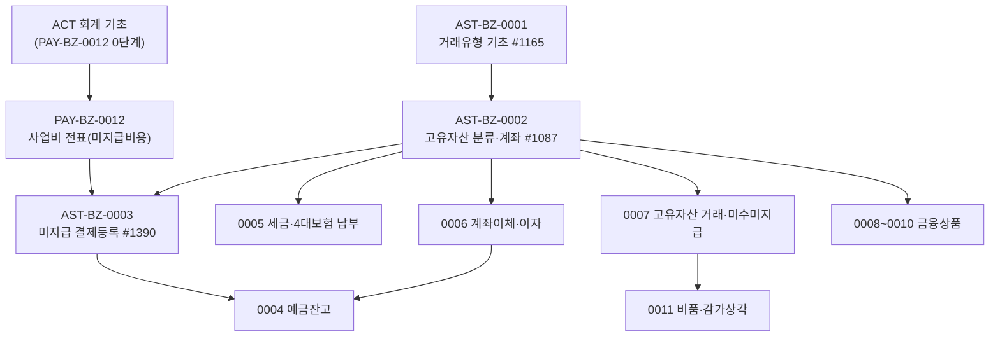

# AST 업무흐름 — 고유자산·자금(예금)·특수회계 (작성 중)

AST는 회사가 가진 자산(예금계좌·금융상품·비품)과 그 거래를 다룬다. 바탕은 **거래유형**(`ast05_tr_code`, KFS가 회사마다 복사, 0001)과 **고유자산 분류·종목**(`ast01_class_tree`, 회사관리자가 회사 0에서 가져오고 계좌를 더함, 0002)이다. 그 위에서 미수/미지급 결제(0003, PAY 사업비의 마지막), 예금잔고(0004), 세금·4대보험 납부(0005), 계좌이체·이자(0006), 고유자산 거래(0007), 금융상품(0008~0010), 비품·감가상각(0011) 등이 일어난다. 거래는 대부분 회계 분개(ACT, `act02`·`act03`)를 함께 만든다 — 회사에 **ACT 회계 기초**(대표계정·실계정맵·분개맵핑)가 있어야 한다(PAY-BZ-0012).

## 화면번호 → 이벤트

| 화면 | 이벤트 |
|:---|:---|
| #1165 거래유형 등록(관리자) · #1090 거래유형 등록 | 0001 |
| #1087 고유자산 기본등록 ① · #1088 고유자산 상세등록 ② · #1089 자산상세 항목관리 | 0002 |
| #1390 미지급반제처리(PAY 메뉴) · #1092 미수/미지급 | 0003 (#1092는 0007) |
| #1238·#1471 예금잔고조회 · #1473·#1159 예금잔고대사 | 0004 |
| #1196 세금/4대보험 등록 | 0005 |
| #1166 계좌이체 · #1472·#1205 예금/예치금 이자수령 | 0006 |
| #1091 고유자산 거래처리 · #1092 미수/미지급 | 0007 |
| #1158·#1160·#1239·#1300·#1208 | 0008 |
| #1295·#1167 | 0009 |
| #1288 | 0010 |
| #1175·#1181·#1397 | 0011 |
| #1299 | 0012 |
| #1171·#1172·#1173·#1365·#1366·#1174 | 0013 |
| #1216·#1401·#1218·#1252·#1201·#1249·#1202·#1251 | 0014 |
| #1342 | 0015 |

펀드자산 메뉴(#1117·#1118·#1119·#1120·#1129, 펀드관리)는 펀드 도메인과 함께 본다.

## TOBE에서 찾은 것 (2026-11-12, 보안·버그 의심 #105~)

| 무엇 | 이벤트 | 내용 |
|:---|:---|:---|
| 사원이 회사 고유자산 종목(계좌)·화면별 거래유형을 등록·삭제(#105) | 0001·0002 | 원본도 메뉴 권한뿐. [기초데이터생성]·[가져오기]는 서버가 막음 |
| [가져오기]가 아무 회사의 분류를 복사하고, 복사본이 원래 회사의 거래처를 가리킴(#106) | 0002 | 원본도 같음 |
| 고유자산 연관문서(대사 결재) 연결을 로그인·회사 검사 없이 ID로 수정(#107, 상) | 0004 | TOBE 컨트롤러에 로그인 정보 없음 |
| 예금잔고대사 [잔고입력] 새 줄 저장 불가 — 읽기 전용 트랜잭션에서 `f_create_seq()`가 NULL(#108) | 0004 | TOBE만. 감가상각·평가·환평가 조회도 같은 모양 |
| 거래별 결제 내역 `GET /ast/settles/by-tr`가 로그인·회사 검사 없이 타사 결제를 돌려줌(#109, 상) | 0007 | TOBE 컨트롤러에 로그인 정보 없음 |
| 회사 0 기초 누락 — #1196 화면별 거래유형 없음·5804 복리후생비 기본 실계정 맵 없음 → 계정 없는 4대보험 분개(#110) | 0005 | 기초 데이터 |
| 로그인 정보 인자 없는 API 16개 — 타사 거래 적요 수정 등(#111, 상) | 0008 | `biz-endpoints ast`로 찾음 |
| 평가처리가 화면의 평가금액·장부금액을 그대로 믿음 — 사원이 평가손익 위조(#112, 상) | 0009 | 원본도 같은 구조 |
| "IPO 자동생성 지정"을 정할 길이 없어 [종목 생성] 불가(#113) | 0010 | TOBE 변환 누락 |
| 회사 0 실계정맵: 상장주식 자산 → 처분이익 계정(#114), 화면별 거래유형 10화면 누락(#110 보강) | 0010 | 기초 데이터 |
