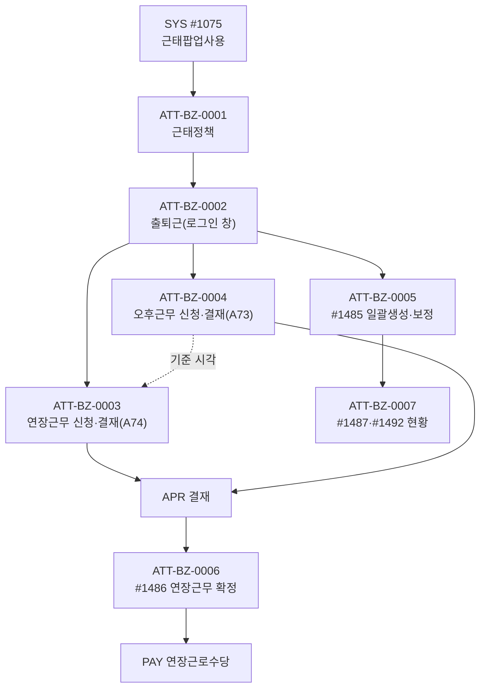

# ATT 업무흐름 — 근태

근태는 **회사 설정(근태팝업) + 근태정책**이 있어야 시작된다(0001). 그 뒤 직원이 날마다 로그인 창에서 출퇴근을 찍고(0002), 연장·오후근무는 결재를 받고(0003·0004), 경영관리팀이 빠진 기록을 만들고 시각을 보정하며(0005), 결재 끝난 연장근무를 확정해 급여로 넘긴다(0006). 현황은 0007.

## 화면번호 → 이벤트

| 화면 | 이벤트 |
|:---|:---|
| #1075 경영·회계 탭(근태 팝업·잠금) | 0001 |
| #1485 근태관리(관리자) · [근태정책설정] | 0001·0005 |
| 로그인 직후 출퇴근 창(메뉴 없음) | 0002 |
| 출퇴근 창 → 연장근무 신청 / 오후근무 신청 | 0003 / 0004 |
| #1486 연장근무관리 | 0006 |
| #1487 근태현황(관리자) · #1492 근태현황 | 0007 |

AS-IS 화면 4개(`yunhee trace-crud -d att`) + 창 9개. `Att03_Tab_OvertimeReq_20260923`·`Att03_Lookup_OvertimeReq_20260902`는 옛 사본(메뉴 없음). `att05_excluded_person`(출퇴근 미사용 사원)은 쓰는 화면이 없다. kalpa에는 근태 메뉴가 없어(S1 상품) 모두 API로 실행했다(2026-11-12).

## TOBE에서 찾은 것 (2026-11-12, 보안·버그 의심 #62~#72)

| 무엇 | 이벤트 | 내용 |
|:---|:---|:---|
| 근태 관리자 API 권한 없음(#62) | 0001·0005·0007 | 사원이 정책 저장·삭제, 본인 근태 시각 보정, 전 직원 근태 조회 |
| 일괄생성이 타사 사원을 받음(#63) | 0005 | 원본도 같음 |
| 정책 필수값 서버 검사 없음(#64) | 0001 | 빈 시각 정책 |
| 연장근무 주간 한도가 화면 기준일에 기댐(#65) | 0003·0004 | `baseDate` 없으면 검사 생략 |
| 결재 ID 연결이 문서 검사 없음(#66, 상) | 0003 | 완료 문서를 붙여 새 신청을 완료로 |
| #1486 확정 권한 없음(#67) · 확정 열이 다른 테이블을 읽음(#68) | 0006 | #68은 TOBE만 |
| 남의 결재완료 오후근무 수정(#69, 상) | 0004 | 수정 SQL에 주인 조건 없음 |
| 연장근무 문서분류를 A73으로 찾음(#70) | 0003 | 원본 버그, TOBE는 A74(다름) |
| 일괄수정 날짜 하나로 여러 날(#71) | 0005 | 원본도 같음 |
| 공통코드 PaymentTypeCode 없음·`연장근로수장` 오타(#72) | 0003·0006 | 데이터 |
