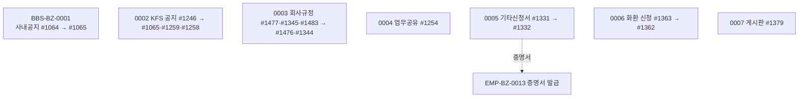

# BBS 업무흐름 — 공지·회사규정·업무공유·신청서·화환·게시판

BBS는 회사 안의 알림과 자료 공유를 맡는다.

1. **사내공지(0001)** — 경영관리팀이 #1064에서 전체공지(01)·개별공지(02, 대상 직원 지정)를 올리면 직원은 #1065 공지사항에서 보고(읽음 기록)·댓글을 단다.
2. **KFS 공지(0002)** — ADMIN이 #1246에서 법령(10)·경영(20)·책무(30)·시스템(90) 공지를 전체 또는 고른 고객사에 올린다. 회사 직원은 #1065와 #1259 경영공지·#1258 법규공지에서 본다.
3. **회사규정(0003)** — 관리자 화면(#1477·#1345, KFS #1483)에서 규정을 등록·개정하면 직원은 #1476·#1344에서 공개·최신 회차를 본다.
4. **업무공유(0004)** — 직원이 #1254에 업무 내용·키워드를 남기고 회사 전체가 본다.
5. **기타신청서(0005)** — 직원이 #1331에서 증명서 등을 신청하면 경영관리가 #1332에서 접수·발급완료로 처리한다(신청서 양식 `bbs12`가 회사에 있어야 목록에 나옴).
6. **화환 신청(0006)** — 직원이 #1363에서 경조 화환을 신청하면 경영관리가 #1362에서 접수·발송완료로 처리한다.
7. **게시판(0007)** — #1379에서 분류(C) 아래 게시판(T)을 만들고 권한(사원 P·부서 O)을 주면 권한자가 글·댓글을 쓴다.

## 1차 목록 (2026-11-14, 메뉴 16개 — 같은 화면이 여러 메뉴)

| ID | 사건 | 주요 화면 | 상태 |
|:---|:---|:---|:---|
| BBS-BZ-0001 | 경영관리팀이 사내공지를 올리고 직원이 본다 | #1064 → #1065 | 실행 |
| BBS-BZ-0002 | KFS가 고객사에 공지를 올린다 | #1246 → #1065·#1259·#1258 | 실행 |
| BBS-BZ-0003 | 회사규정을 등록하고 직원이 본다 | #1477·#1345·#1483 → #1476·#1344 | 실행 |
| BBS-BZ-0004 | 직원이 업무를 공유한다 | #1254 | 실행 |
| BBS-BZ-0005 | 직원이 기타신청서를 내고 경영관리가 처리한다 | #1331 → #1332 | 실행 |
| BBS-BZ-0006 | 직원이 화환을 신청하고 경영관리가 처리한다 | #1363 → #1362 | 실행 |
| BBS-BZ-0007 | 게시판을 만들고 권한자가 글을 쓴다 | #1379 | 실행 |

## 화면번호 → 이벤트

| 화면 | 이벤트 |
|:---|:---|
| #1064 커뮤니티 > 02. 공지사항 > 사내공지등록 · #1065 공지사항 | 0001 (0002 보기) |
| #1246 커뮤니티 > 02. 공지사항 > KFS공지등록 · #1259 경영관리 > 경영공지 · #1258 준법감시 > 법규공지 | 0002 |
| #1477·#1345 회사규정(관리자) · #1483 기초자료 > 10. 책무 > 회사규정관리 · #1476·#1344 회사규정 | 0003 |
| #1254 커뮤니티 > 03. 업무활동 > 업무공유 | 0004 |
| #1331 신청 > 90. 기타신청 > 기타신청서 작성 · #1332 경영관리 > 90. 신청서관리 > 기타신청서 확인 | 0005 |
| #1363 신청 > 90. 기타신청 > 화환 신청 · #1362 경영관리 > 90. 신청서관리 > 화환신청 확인 | 0006 |
| #1379 커뮤니티 > 05. 게시판 > 게시판 | 0007 |

## 메뉴가 열린 회사 (2026-11-14)

- #1065 13곳·#1064 11곳 … #1483은 ADMIN(0)만. kalpa는 #1476·#1477(회사규정)만 열려 있다 — 나머지는 API로 실행(김과장 301 = 경영관리, 김사원 401·최사원 402). KFS 공지는 ADMIN `admin/admin/1111`(104는 KFS관리자 아님 → 403).

## 시작 점검 (2026-11-14 `yunhee biz-endpoints bbs`)

API 88개 · 쓰기 49 · `⚠없음` 13(쓰기 6: 게시판 권한 PUT·DELETE, 공지 대상 DELETE 2, 화환 기본공유 POST, 게시판 next-id). 쓰기 중 '회사'만 20 — 경영관리용 처리 API를 사원이 부른다(⚠#258·#259).

## 남긴 것 (2026-11-14, kalpa)

공지 3건(개별 `202611149151586` 대상 401·전체 `…589` 상단고정·KFS 경영공지 `…598`, 회사 0), 댓글 2(401 `…597`, 402 `…596`), 읽음 1. 회사규정 `여비규정` `…611`. 업무공유 `…614`. 신청서 양식 `bbs12` +4(`…617`~`…620`), 재직증명서 신청 `…615`(발급완료). 화환 `…622`(발송완료). 게시판 분류 `10. 업무자료` `…624`·게시판 `경영지원 자료실` `…625`(권한 부서 `…626`·김사원 `…630`), 글 `…631`·댓글 `…632`.
