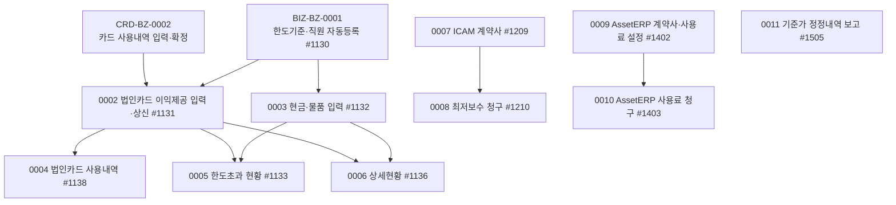

# BIZ 업무흐름 — 이익제공(수령)·KFS 계약사·사용료

`biz` 패키지에는 성격이 다른 업무 둘이 같이 있다.

1. **이익제공(수령) 통제(준법감시, 고객사)** — 영업규정상 거래상대방에게 주거나 받은 편익(식사·골프·선물·경조금…)을 기록하고 한도를 점검한다. 준법감시인이 **한도기준**(0001)을 정하면, 직원이 **법인카드 사용내역**(CRD-BZ-0002에서 올라온 `biz01_promo` 행)에 제공 목적·내용·인원을 입력해 상신하거나(0002) **현금·물품** 제공을 직접 입력한다(0003). 준법감시인은 사용내역·한도초과·상세현황을 본다(0004~0006).
2. **KFS 영업관리(KFS 전용 메뉴)** — KFS가 ICAM 고객 계약사와 최저보수 청구(0007·0008), AssetERP 고객 계약사와 사용료 청구(0009·0010), 펀드 기준가 정정내역 보고(0011)를 관리한다.

같은 패키지의 법인카드 화면(#1141 내역관리·#1406 실사용자 배분·#1333 법인카드 현황·#1335 접대비 현황)은 [CRD 흐름도](../CRD/CRD-업무흐름.md)에서 다뤘다.

## 1차 목록 (2026-11-14, 메뉴 15개)

| ID | 사건 | 주요 화면 | 상태 |
|:---|:---|:---|:---|
| BIZ-BZ-0001 | 준법감시인이 이익제공(수령) 한도기준을 정하고 직원 자동등록을 설정한다 | #1130 | 실행 |
| BIZ-BZ-0002 | 직원이 법인카드 사용내역에 이익제공 내용을 입력하고 상신한다 | #1131 (#1319) | 실행 |
| BIZ-BZ-0003 | 직원이 현금·물품 이익제공(수령)을 입력한다 | #1132 (#1320) | 실행 |
| BIZ-BZ-0004 | 준법감시인이 법인카드 사용내역을 본다 | #1138 (#1321) | |
| BIZ-BZ-0005 | 준법감시인이 편익상대방 한도초과 현황을 본다 | #1133 | |
| BIZ-BZ-0006 | 준법감시인이 이익제공(수령) 상세현황을 본다 | #1136 (#1322) | |
| BIZ-BZ-0007 | KFS가 ICAM 계약사를 관리한다 | #1209 | |
| BIZ-BZ-0008 | KFS가 ICAM 최저보수를 청구한다 | #1210 | |
| BIZ-BZ-0009 | KFS가 AssetERP 기본설정·계약사·사용료 설정을 관리한다 | #1402 | |
| BIZ-BZ-0010 | KFS가 AssetERP 사용료를 청구한다 | #1403 | |
| BIZ-BZ-0011 | KFS가 펀드 기준가 정정내역을 보고한다 | #1505 | |

## 화면번호 → 이벤트

| 화면 | 이벤트 |
|:---|:---|
| #1130 이익제공 기준관리(준감인) | 0001 |
| #1131 이익제공 입력(법인카드) · #1319 (s)이익제공입력(카드) | 0002 |
| #1132 이익제공 입력(현금,물품) · #1320 (s)이익제공입력(현금,물품) | 0003 |
| #1138 법인카드 사용내역 조회 · #1321 (s)법인카드사용내역 | 0004 |
| #1133 편익상대방 이익제공 현황 | 0005 |
| #1136 이익제공 상세현황 · #1322 (s)이익제공 상세현황 | 0006 |
| #1209 ICAM 계약사 관리 | 0007 |
| #1210 최저보수 청구 | 0008 |
| #1402 AssetERP 계약사관리 | 0009 |
| #1403 AssetERP 사용료청구 | 0010 |
| #1505 기준가 정정내역 보고 | 0011 |
| #1141 · #1406 · #1333 · #1335 (법인카드) | CRD-BZ-0003·0005 |

## TOBE에서 찾은 것 (2026-11-14, 보안·버그 의심 #231~)

| 무엇 | 이벤트 | 내용 |
|:---|:---|:---|
| 사원이 이익제공 한도·직원 자동등록 설정을 고침(#231, 상) | 0001 | 원본도 회사 조건뿐 |
| 고객사 사원이 KFS의 ERP 계약사·사용료 자료를 봄(#232, 상) | 0009·0010 | 검사 `⚠없음` 21개 API |
| 마감·A41 완료 내역을 API로 수정, 같은 회사 남의 내역에 인원 추가(#233) | 0002 | 원본도 화면 검사뿐(첫 행만 봄) |
| A41 문서분류가 회사 0에도 없음 → 새 고객사는 법인카드 이익제공을 못 올림 | 0002 | kalpa는 이번에 지정 |
| 남의 현금·물품 내역 수정, 삭제 API가 카드 내역까지 지움(#234, 상) | 0003 | 원본은 회사 조건도 없음 |
