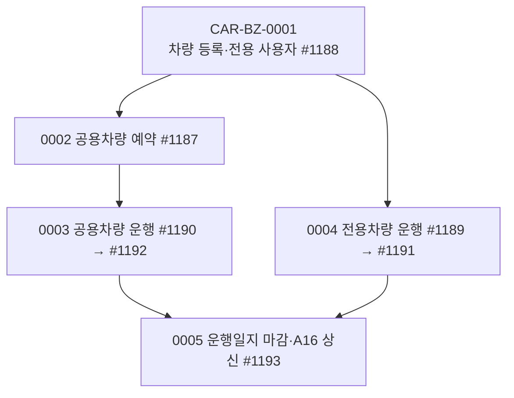

# CAR 업무흐름 — 차량관리(차량·예약·운행일지·마감 결재)

1. **차량 등록(0001)** — 경영관리팀이 #1188에서 차량(`car01_info`: 구분 1 전용 / 2 공용, 번호·이름·초기 주행거리)을 등록하고, 전용차량에는 사용자(`car02_user`, 기간)를 붙인다.
2. **공용차량 예약(0002)** — 직원이 #1187에서 날짜·시간대·행선지·목적으로 예약한다(`car03_booking`, 여러 날이면 날마다 행 — 첫 행이 부모). 같은 차·시간이 겹치면 거절.
3. **공용차량 운행(0003)** — 예약한 직원이 #1190에서 예약마다 주행거리·행선지를 넣고(`car04_journal`, 예약 ID) [확정]. 경영관리는 #1192에서 회사 전체를 보고 고친다.
4. **전용차량 운행(0004)** — 전용차 사용자가 #1189에서 날마다 주행거리(출퇴근·업무·비업무)를 넣고 [확정]([일괄등록]은 영업일마다 같은 내용). 경영관리는 #1191에서 고친다.
5. **운행일지 마감·결재(0005)** — 경영관리가 #1193에서 차량·월을 골라 [마감](주행 전·후 계기판 저장) → [상신]으로 **A16** 결재(`car05_relate_appr`). 이전 달이 마감 안 됐으면 마감 거절, 이후 달이 마감됐으면 마감취소 거절.

## 1차 목록 (2026-11-14, 메뉴 7개)

| ID | 사건 | 주요 화면 | 상태 |
|:---|:---|:---|:---|
| CAR-BZ-0001 | 경영관리팀이 차량을 등록하고 전용차량 사용자를 정한다 | #1188 | 실행 |
| CAR-BZ-0002 | 직원이 공용차량을 예약한다 | #1187 | 실행 |
| CAR-BZ-0003 | 직원이 공용차량 운행을 등록·확정한다 | #1190 → #1192 | 실행 |
| CAR-BZ-0004 | 전용차량 사용자가 운행을 등록·확정한다 | #1189 → #1191 | 실행 |
| CAR-BZ-0005 | 경영관리팀이 운행일지를 마감하고 결재(A16)받는다 | #1193 | 실행 |

## 화면번호 → 이벤트

| 화면 | 이벤트 |
|:---|:---|
| #1188 경영관리 > 10. 차량관리 > 차량정보관리 | 0001 |
| #1187 공용차량 예약관리 | 0002 |
| #1190 공용차량 운행등록 · #1192 공용차량 운행변경(경영관리팀) | 0003 |
| #1189 전용차량 운행등록 · #1191 전용차량 운행변경(경영관리팀) | 0004 |
| #1193 차량 운행일지 | 0005 |

## 메뉴가 열린 회사 · 시작 점검

- kalpa에는 차량관리 메뉴가 없어 API로 실행했다(경영관리 301, 직원 401·402, 대표이사 100, 결재자 201).
- `yunhee biz-endpoints car`: API 34개 · 쓰기 11 중 '회사'만 9 · `⚠없음` 4(템플릿 등). 경영관리용 쓰기(차량·마감·확정 변경)를 사원이 부른다(⚠#261·#263).

## 남긴 것 (2026-11-14, kalpa)

차량 `공용 쏘나타 12가3456`(`202611149151635`)·`대표이사 전용 그랜저 34나7890`(`…636`, 사용자 김사장 `…637`). 401 예약 11-13(`…640`)·공용 일지 `…641`(42km, 확정). 김사장 전용 일지 11-12·13(`…643`·`…644`, 확정·마감). A16 결재 완료 `202611149151649`(연결 `car05` `…646`), kalpa A16 문서분류 → `총무/업무용차량/차량운행일지`(회사 0에도 A16 지정 없음).

## 다른 도메인에서 한 것

- EST 부동산PF 용역(#1375~#1378·#1382)은 FND-BZ-0009, CHK 펀드회계 일일점검(#1240~#1243)은 FND-BZ-0010. EST `(X)02. 부동산` 5화면(#1056~#1060)은 TOBE 화면 없음.
