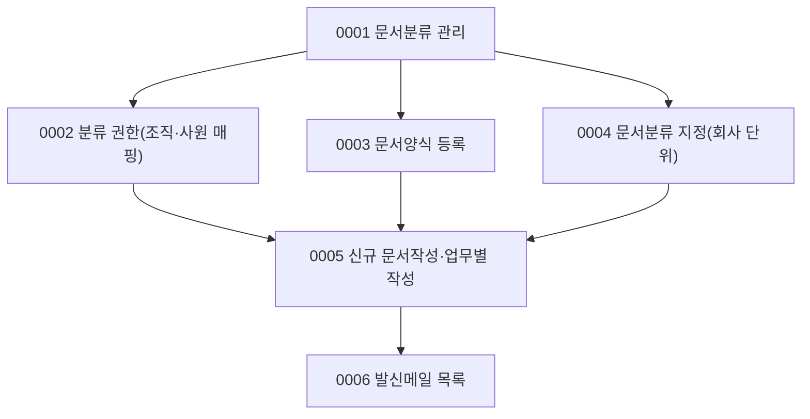

# DCR 업무흐름 — 문서작성(문서분류·문서양식·문서권한) (작성 중)

메뉴 `문서작성`(31개)은 결재문서를 쓰는 입구다. 문서 **작성·상신·결재**는 APR 이벤트(0001~0012)가 이미 다뤘고, DCR은 그 앞의 **문서분류(업무 트리) → 분류별 양식·결재선·인감 → 조직·사원 권한 → 작성 화면** 기초를 다룬다. 업무분석 순서는 기초 설정이 먼저다.

| ID | 사건 | 주요 화면 | 상태 |
|:---|:---|:---|:---|
| DCR-BZ-0001 | 문서분류(업무 트리)를 만들고 고친다 | #1001 (#1110 KFS) | 실행 |
| DCR-BZ-0002 | 분류별 조직·사원 권한을 준다 | #1073, #1074, #1491 | 실행 |
| DCR-BZ-0003 | 문서양식을 등록·고친다 | #1007 (#1482 KFS) | 실행 |
| DCR-BZ-0004 | 문서분류를 회사에 지정한다 | #1280 | 대기 |
| DCR-BZ-0005 | 새 문서·업무별 문서를 작성한다 | #1318, #1002, #1014, #1003 | 대기 |
| DCR-BZ-0006 | 발신메일을 확인한다 | #1023, #1024 | 대기 |

## 화면번호 → 이벤트

| 화면 | 이벤트 |
|:---|:---|
| #1001 관리자 > 03. 문서관리 > 문서분류 | 0001 |
| #1073 · #1074 문서권한 · #1491 조회권한 예외사원 | 0002 |
| #1007 문서양식등록 · #1482 문서양식등록(KFS) | 0003 |
