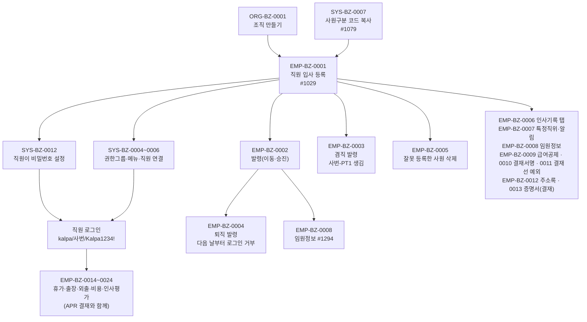

# EMP 업무흐름 — 사원

**직원을 한 명씩 입사 등록한다.** 등록하면 사람·발령(입사)·급여공제까지 한 번에 만들어지지만, **로그인하려면 직원이 비밀번호를 직접 정해야** 하고 메뉴를 보려면 **권한그룹(SYS-BZ-0004~0006)**도 필요하다.

그 다음 사원의 일생은 **발령(`emp03_trans`)이 날짜별로 쌓이는 것**이다(채용 100 → 이동 200 · 승진 300 · 승급 400 → 퇴직 900, 겸직 800은 겸직용 사원에). 기준일로 조회하면 그날의 소속·직위가 나온다. 사원은 지우지 않고 퇴직시킨다.

EMP 영역은 화면 40개다(`yunhee trace-crud -d emp`). 인사(#1029)·임원(#1294)과 휴가·출장·외출·비용·인사평가(EMP-BZ-0014~0024)를 실행했다. 휴가·출장·비용 신청은 **전자결재(APR)**로 넘어가므로 APR 도메인과 함께 해야 끝까지 따라갈 수 있다.

## 가상 회사 kalpa의 메뉴 범위

**상품 S1(출발지 `prod_s1`)의 EMP 메뉴는 #1029 사원정보 관리 · #1030 조직별 사원조회 · #1283 사원별 메뉴권한(View) 셋뿐이다**(`sys03_company_menu`). #1277 급여공제·#1294 임원정보·#1501 결재서명·#1439 결재선 예외·#1032 휴가신청 같은 업무 화면은 회사 메뉴에 아예 없다(asseterpdb에서 이 메뉴들은 S1이 아닌 회사 5~11곳에만 있다). 그래서 EMP-BZ-0008~0011은 메뉴 없이 **TOBE API로만** 실행했다(API는 메뉴 권한을 보지 않는다).

**2026-11-10 사용자 결정으로 kalpa에만 EMP 업무 메뉴 29개를 열었다**(kova·igo는 그대로):

1. KFS 관리자 `admin/admin/1111` → **#1076** 관리자 > 01. 고객관리 > 회사별 메뉴맵핑: 메뉴 29개 + 상위 폴더 10개(문서작성 > 04. 전자결재·05. 메일관리, 경영관리 > 02. 휴가/출장 관리·04. 급여관리·05. 인사평가, 신청 > 01. 외출/출장/휴가·80. 사업비 신청, 자금관리 > 20. 사업비관리)를 사용으로 넣음 → `sys03_company_menu` +39. API `PUT /api/v1/sys/menus/companies/{회사ID}` (SYS-BZ-0003의 #1076 방식)
2. kalpa 관리자 `kalpa/admin/1111` → **#1070** 권한그룹별 메뉴: 아래처럼 나눠 줌 → `sys07_role_menu` +45. API `PUT /api/v1/sys/roles/{roleId}/menus` (SYS-BZ-0005)

| 권한그룹 | 받는 사람 | 새 메뉴 |
|:---|:---|:---|
| 일반 사용자 (+14줄) | 직원 7명 | #1501 결재서명, #1025 주소록, #1032 휴가신청 · #1034 휴가신청조회 · #1184 연월차휴가 지정통보 · #1358 외출등록 · #1359 출장품의, #1221 복리후생비 신청 · #1349 여비교통비 신청 |
| 경영 관리자 (+27줄) | 과장 | #1439 결재선 예외, #1211 공용주소록, #1115 증명서 발급, #1294 임원정보, #1033·#1035·#1185·#1233·#1234·#1381·#1465 휴가/출장 관리, #1277 급여공제, #1391·#1392·#1393·#1394·#1396 인사평가, #1222·#1348 사업비관리 |
| 임원 (+4줄) | 사장·부장 | #1393 인사평가수행(평가자) · #1395 인사평가보고(대표이사) · #1396 결과조회 |

- 결과 메뉴 수: 관리자 59 → 88 · 사장·부장 15 → 27 · 과장 30 → 58 · 사원 12 → 21.
- `#1373 복리후생비 코드관리`(기초자료 > 30. 자산&경영)는 **ADMIN(회사 0) 전용**이라 넣지 않았다 → EMP-BZ-0021은 KFS 관리자 이벤트다.
- SYS-BZ-0011(특정화면 사용요청)로는 열 수 없다: 특정업무는 문서상신·기타·급여(연봉)관리·인감관리 넷뿐이고, 회사 메뉴에 있는 것을 일부 사람에게 좁혀 줄 뿐이다.
- 나눈 기준은 메뉴 위치다(신청 → 직원, 경영관리·자금관리 → 과장, 평가자·대표이사 보고 → 임원). 원본 고객사의 실제 배분과 다를 수 있다.

## 상태가 바뀌는 것

| 무엇 | 값 | 바꾸는 이벤트 |
|:---|:---|:---|
| 재직 상태(`emp03_trans`) | 채용 → 이동·승진·승급 → 퇴직(900, 다음 날부터) | EMP-BZ-0001, 0002, 0004 |
| 겸직(`emp04_add_title` + 겸직용 사원) | 없음 → 겸직 → 삭제 | EMP-BZ-0003 |
| 비밀번호(`sys25_password`) | 없음 → 본인이 설정 | SYS-BZ-0012 |

## 화면번호 → 이벤트

| 화면 | 쓰는 이벤트 |
|:---|:---|
| #1029 사원정보 관리 (#1452 같은 화면) | EMP-BZ-0001([등록]) · 0002·0004(일반발령 탭) · 0003(겸직 탭) · 0005(인적사항 [삭제]) · 0006(나머지 탭) · 0007([특정직위 및 알림설정]) |
| #1030 조직별 사원조회, #1031 조직별 사원조회(관리자) | 결과 확인 |
| #1182 비밀번호 초기화 | SYS-BZ-0012(초기화) |
| 그 밖의 화면 | [README 이벤트 목록](../README.md) 참조 |

## TOBE에서 찾은 것 (2026-11-10)

| 무엇 | 이벤트 | 내용 | 원본 변경일 |
|:---|:---|:---|:---|
| 일반발령 [임원] 열 없음 | EMP-BZ-0002 | `emp03_director_yn`이 TOBE 그리드·저장에 없다 | 2026-03-12·16 |
| [등록] 복사 값이 옛 방식 | EMP-BZ-0002 | 원본은 최근 발령에서 8개 값을 더 복사한다 | 2026-08-26 |
| 겸직 삭제 때 삭제 이력 없음 | EMP-BZ-0003 | 원본은 `emp99_person_del`에 남긴다 | — |
| 사원 삭제 사용 검사 없음 | EMP-BZ-0005 | `f_check_use_person_id` > 0이면 막아야 한다(로그인 기록도 셈) | 2026-08-11 |
| 사원 삭제 겸직 검사가 로그인 사용자 기준 | EMP-BZ-0005 | 원본은 선택한 사원 기준으로 고쳤다 | 이후 |
| 경력 탭 년월 형식 검사 없음 | EMP-BZ-0006 | `15년3월` 같은 값이 저장된다 | 2026-05-11 |
| 학력 탭 7자리 검사 없음 | EMP-BZ-0006 | 8자리 입력 → 500 "서버 내부 오류" | 2024-07-10 |
| 자격 탭 하위 "금융투자전문인력구분" 그리드 없음 | EMP-BZ-0006 | `emp32_relate_license` 등록·저장·삭제 전체가 없다("C01-5에서 구현"으로 미룸) | 2023-08 |
| 가족관계가 콤보가 아니라 글자 입력 | EMP-BZ-0006 | `FamilyRelateCode2` 코드가 그대로 보이고 아무 글자나 저장 | 2026-03-18 |
| 교육 탭 [교육기관] 열 없음 | EMP-BZ-0006 | 원본 4열 / TOBE 3열 | 2026-08-20 |
| 인적사항 사진 올리기 없음 | EMP-BZ-0006 | "파일 공통(B10) 뒤"로 미룸 — B10은 이미 있음 | — |
| 인사평가 평가부서·담당자 사원 선택 창 없음 | EMP-BZ-0006 | TOBE가 텍스트 입력으로 단순화(원본 이벤트 E5 빠짐) | — |
| 추가인적공제 조회·저장에 회사 검사 없음(보안) | EMP-BZ-0009 | 다른 회사 공제 ID로 읽힘(실행 확인), 저장도 가능 | — |
| 결재선 예외: 사원 없으면 500, 다른 회사 사원도 등록 | EMP-BZ-0011 | 필수·소속 검사 없음 | — |
| 다른 회사 주소록 그룹 구성원(이메일·휴대폰)이 보임(보안) | EMP-BZ-0012 | 그룹 구성원 조회 API가 로그인 회사를 안 봄(실행 확인) | — |
| 같은 회사 직원이 남의 개인 주소록 수정·공용 항목 삭제 | EMP-BZ-0012 | 저장·삭제가 등록자를 안 봄(실행 확인) | — |
| 신청내역으로 증명서 발급해도 신청 상태 그대로 | EMP-BZ-0013 | `updateAppStatus`(10 → 20) "다음 단계"로 미룸 | — |
| 임원정보에 비등기 임원을 새로 올릴 길 없음 | EMP-BZ-0008 | [임원] 열이 없어서(위 0002 ⚠1) 등기임원만 가능 | 2026-03 |
| EMP-BZ-0015·0016·0017 서버 검사가 화면에만 있음(보안·버그 의심 #1~#6) | EMP-BZ-0015~0017 | 지정통보 상신 제한, 공동연차·포상휴가 수정·삭제·한도 검사, 결재문서 ID 소유 미검사, 삭제 때 고아 행 | — |
| 외출 삭제 때 공유 행이 남음 · 메뉴 권한 없는 사원이 회사 전체 외출 조회(#7·#9) | EMP-BZ-0018 | `emp56_share` 고아, #1465 조회에 권한 검사 없음 | — |
| 결재 ID 붙이기에 존재·소유 검사 없음(#8) | EMP-BZ-0018·0019·0020 | 없는 ID `999`가 붙고 상신 실패 후에도 남음 | — |
| 메뉴 권한 없는 사원이 회사 전체 출장 조회·결과보고 면제 변경(#10) | EMP-BZ-0019 | #1381 `GET/PUT /biz-trips` | — |
| 결과보고서는 신청서 완료 뒤라는 규칙·종료일 검사가 화면에만 있음(#11) | EMP-BZ-0019 | 서버 시드·`appr-id`가 신청서 상태를 안 봄 | — |
| 여비교통비 마감 순서 검사가 화면에만 있음 · 사원이 전체 신청서 조회(#12) | EMP-BZ-0020 | 지출결의 상신 중 마감, 완료 뒤 마감 취소가 통과 | — |
| 기초데이터 복사 시 중복 행(#13) | EMP-BZ-0021 | 같은 코드를 다시 복사하면 중복 | — |
| 직원이 복리후생비 설정 저장·삭제(#14), 지급확인·알림 변경(#15) | EMP-BZ-0021·0022 | 메뉴 권한 검사 없음(원본은 코드 미확인) | — |
| 지출결의 등록이 결재 없는 신청에도 기준년월을 씀(#16) | EMP-BZ-0022 | `updatePayRequestYm`, 클라이언트 값 신뢰 | — |
| 인사평가 가중치 합·확정 뒤 수정 금지가 화면에만 있음(#17) | EMP-BZ-0023 | 합 150 저장, 확정된 항목 수정·삭제, `emp44` 고아 | — |
| 인사평가 대상자 비중 합·자기평가 중복 저장(#18), 항목 일부만 작성하고 평가완료(#19) | EMP-BZ-0024 | 서버 검사 없음 | — |
| 결재 완료 뒤에도 평가취소·재완료·가감 수정 가능(#20) | EMP-BZ-0024 | 결재 문서 점수와 DB 점수 불일치 가능 | — |
| 인사평가 컨트롤러에 권한 검사 없음 — 사원이 대표이사 가점 저장·전체 점수 조회(#21, 상) | EMP-BZ-0024 | `EmpEvalTargetController` 전체 | — |
| 평가 작성 행이 있으면 진행상태가 늘 `진행중`(#22) | EMP-BZ-0024 | 원본도 같음(`emp43.selectByTermCode`) | — |

대부분 drift 기준(`546a87d`)보다 앞선 원본 변경이라 `yunhee drift`에는 안 걸린다. 변환할 때 빠진 것이다.
| 값 검사가 서버에 없음: 외출(#51)·출장 구분 코드(#53)·여비교통비 음수 금액(#54)·복리후생비 설정(#55)·복리후생비 신청(#58)·인사평가 가중치(#60) | EMP-BZ-0018~0023 | 별도 세션에서 확인한 것을 합침 |
| 외출 삭제 때 완료+미상신 행을 같이 고르면 둘 다 삭제(#52, 이상한점 #101) | EMP-BZ-0018 | |
| 직원이 남의 신청 결재문서 폐기(#56)·알림 임의 발송(#57) | EMP-BZ-0022 | |
| 인사평가 기준 API 전부에 권한 검사 없음(#59) · 회사 0 최신 기준에 가중치 0 항목(#61) | EMP-BZ-0023 | #1391·#1398 |
