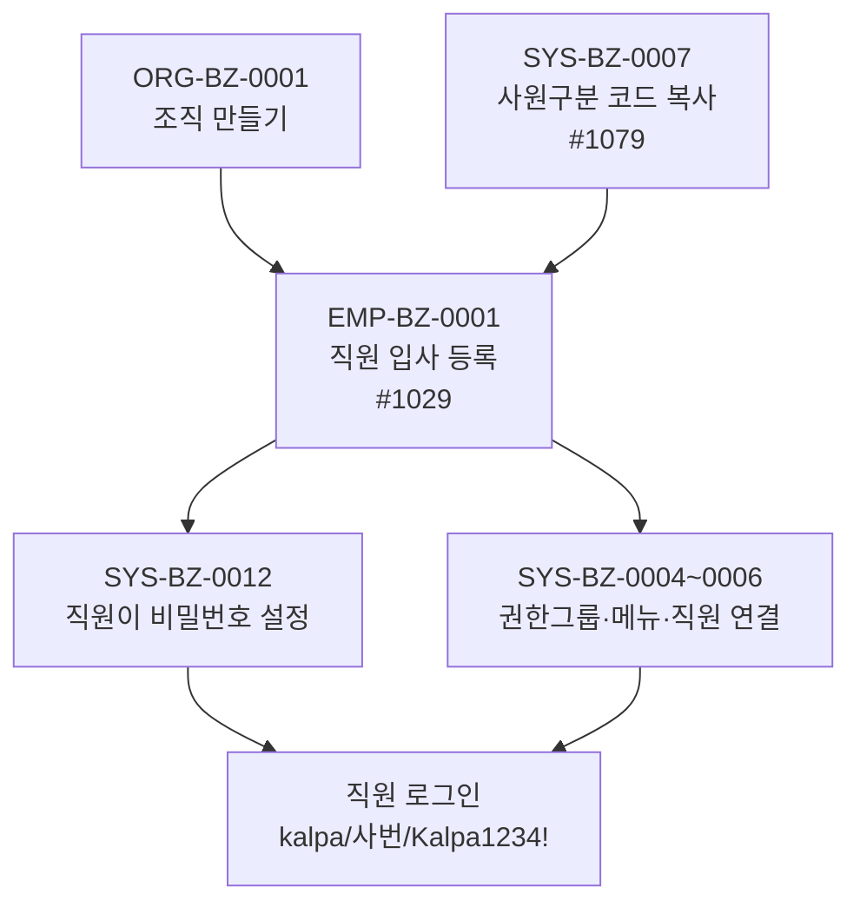

# EMP 업무흐름 — 사원

**직원을 한 명씩 입사 등록한다.** 등록하면 사람·발령(입사)·급여공제까지 한 번에 만들어지지만, **로그인하려면 직원이 비밀번호를 직접 정해야** 하고 메뉴를 보려면 **권한그룹(SYS-BZ-0004~0006)**도 필요하다.

## 상태가 바뀌는 것

| 무엇 | 값 | 바꾸는 이벤트 |
|:---|:---|:---|
| 재직 상태(`emp03_trans`) | 입사 발령 | EMP-BZ-0001 |
| 비밀번호(`sys25_password`) | 없음 → 본인이 설정 | SYS-BZ-0012 |

## 화면번호 → 이벤트

| 화면 | 쓰는 이벤트 |
|:---|:---|
| #1029 사원정보 관리 | EMP-BZ-0001([등록]) |
| #1030 조직별 사원조회 | 결과 확인 |
| #1182 비밀번호 초기화 | SYS-BZ-0012(초기화) |
