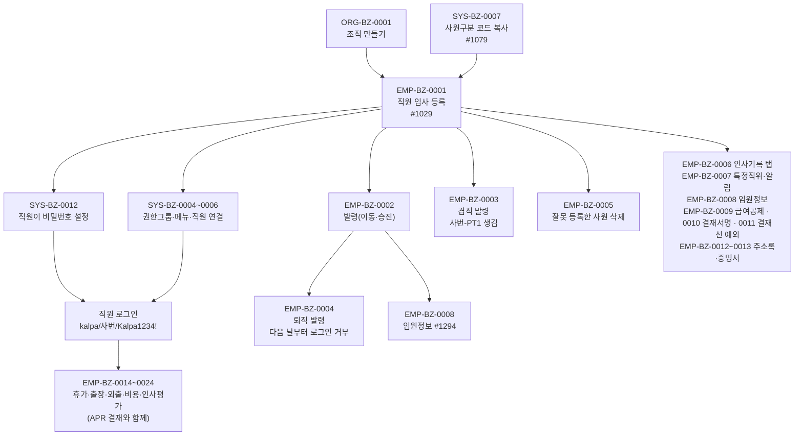

# EMP 업무흐름 — 사원

**직원을 한 명씩 입사 등록한다.** 등록하면 사람·발령(입사)·급여공제까지 한 번에 만들어지지만, **로그인하려면 직원이 비밀번호를 직접 정해야** 하고 메뉴를 보려면 **권한그룹(SYS-BZ-0004~0006)**도 필요하다.

그 다음 사원의 일생은 **발령(`emp03_trans`)이 날짜별로 쌓이는 것**이다(채용 100 → 이동 200 · 승진 300 · 승급 400 → 퇴직 900, 겸직 800은 겸직용 사원에). 기준일로 조회하면 그날의 소속·직위가 나온다. 사원은 지우지 않고 퇴직시킨다.

EMP 영역은 화면 40개다(`yunhee trace-crud -d emp`). 인사(#1029)·임원(#1294)을 실행했고, 휴가·출장·비용·인사평가는 1차 목록이다. 휴가·출장·비용 신청은 **전자결재(APR)**로 넘어가므로 APR 도메인과 함께 해야 끝까지 따라갈 수 있다.

## 가상 회사 kalpa의 메뉴 범위

**kalpa·kova·igo(상품 S1, 출발지 `prod_s1`)에서 열리는 EMP 메뉴는 #1029 사원정보 관리 · #1030 조직별 사원조회 · #1283 사원별 메뉴권한(View) 셋뿐이다**(`sys03_company_menu`, 2026-11-10). #1277 급여공제·#1294 임원정보·#1501 결재서명·#1439 결재선 예외·#1032 휴가신청 같은 업무 화면은 회사 메뉴에 아예 없다(asseterpdb에서 이 메뉴들은 S1이 아닌 회사 5~11곳에만 있다).

- 그래서 EMP-BZ-0008~0011은 **TOBE API로만** 실행했다(API는 메뉴 권한을 보지 않는다). "따라 하기"의 화면 순서는 원본 기준이다.
- 화면으로 따라 하려면 먼저 메뉴를 열어야 한다: SYS-BZ-0011(특정화면 사용요청 → KFS 승인) 또는 SYS-BZ-0003을 더 큰 상품의 회사에서 다시 복사. 휴가·출장(0014~)은 직원이 직접 신청하는 화면이라 이 결정 없이는 시나리오가 안 이어진다 — **사용자 결정 대기**.

## 상태가 바뀌는 것

| 무엇 | 값 | 바꾸는 이벤트 |
|:---|:---|:---|
| 재직 상태(`emp03_trans`) | 채용 → 이동·승진·승급 → 퇴직(900, 다음 날부터) | EMP-BZ-0001, 0002, 0004 |
| 겸직(`emp04_add_title` + 겸직용 사원) | 없음 → 겸직 → 삭제 | EMP-BZ-0003 |
| 비밀번호(`sys25_password`) | 없음 → 본인이 설정 | SYS-BZ-0012 |

## 화면번호 → 이벤트

| 화면 | 쓰는 이벤트 |
|:---|:---|
| #1029 사원정보 관리 (#1452 같은 화면) | EMP-BZ-0001([등록]) · 0002·0004(일반발령 탭) · 0003(겸직 탭) · 0005(인적사항 [삭제]) · 0006(나머지 탭) · 0007([특정직위 및 알림설정]) |
| #1030 조직별 사원조회, #1031 조직별 사원조회(관리자) | 결과 확인 |
| #1182 비밀번호 초기화 | SYS-BZ-0012(초기화) |
| 그 밖의 화면 | [README 이벤트 목록](../README.md) 참조 |

## TOBE에서 찾은 것 (2026-11-10)

| 무엇 | 이벤트 | 내용 | 원본 변경일 |
|:---|:---|:---|:---|
| 일반발령 [임원] 열 없음 | EMP-BZ-0002 | `emp03_director_yn`이 TOBE 그리드·저장에 없다 | 2026-03-12·16 |
| [등록] 복사 값이 옛 방식 | EMP-BZ-0002 | 원본은 최근 발령에서 8개 값을 더 복사한다 | 2026-08-26 |
| 겸직 삭제 때 삭제 이력 없음 | EMP-BZ-0003 | 원본은 `emp99_person_del`에 남긴다 | — |
| 사원 삭제 사용 검사 없음 | EMP-BZ-0005 | `f_check_use_person_id` > 0이면 막아야 한다(로그인 기록도 셈) | 2026-08-11 |
| 사원 삭제 겸직 검사가 로그인 사용자 기준 | EMP-BZ-0005 | 원본은 선택한 사원 기준으로 고쳤다 | 이후 |
| 경력 탭 년월 형식 검사 없음 | EMP-BZ-0006 | `15년3월` 같은 값이 저장된다 | 2026-05-11 |
| 학력 탭 7자리 검사 없음 | EMP-BZ-0006 | 8자리 입력 → 500 "서버 내부 오류" | 2024-07-10 |
| 자격 탭 하위 "금융투자전문인력구분" 그리드 없음 | EMP-BZ-0006 | `emp32_relate_license` 등록·저장·삭제 전체가 없다("C01-5에서 구현"으로 미룸) | 2023-08 |
| 가족관계가 콤보가 아니라 글자 입력 | EMP-BZ-0006 | `FamilyRelateCode2` 코드가 그대로 보이고 아무 글자나 저장 | 2026-03-18 |
| 교육 탭 [교육기관] 열 없음 | EMP-BZ-0006 | 원본 4열 / TOBE 3열 | 2026-08-20 |
| 인적사항 사진 올리기 없음 | EMP-BZ-0006 | "파일 공통(B10) 뒤"로 미룸 — B10은 이미 있음 | — |
| 인사평가 평가부서·담당자 사원 선택 창 없음 | EMP-BZ-0006 | TOBE가 텍스트 입력으로 단순화(원본 이벤트 E5 빠짐) | — |
| 추가인적공제 조회·저장에 회사 검사 없음(보안) | EMP-BZ-0009 | 다른 회사 공제 ID로 읽힘(실행 확인), 저장도 가능 | — |
| 결재선 예외: 사원 없으면 500, 다른 회사 사원도 등록 | EMP-BZ-0011 | 필수·소속 검사 없음 | — |
| 임원정보에 비등기 임원을 새로 올릴 길 없음 | EMP-BZ-0008 | [임원] 열이 없어서(위 0002 ⚠1) 등기임원만 가능 | 2026-03 |

대부분 drift 기준(`546a87d`)보다 앞선 원본 변경이라 `yunhee drift`에는 안 걸린다. 변환할 때 빠진 것이다.
