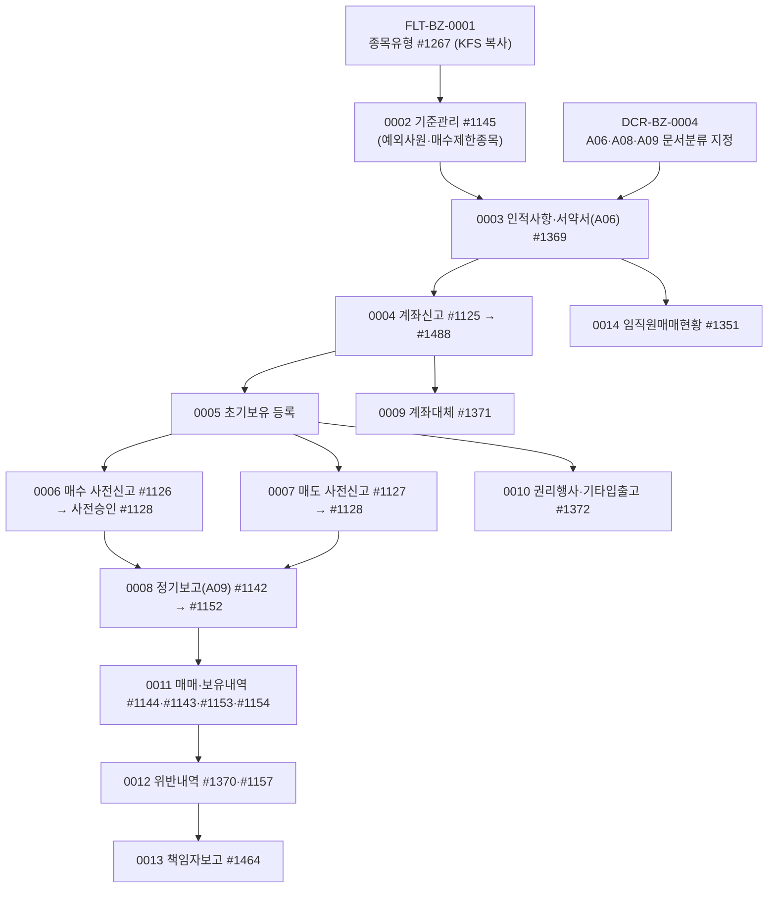

# FLT 업무흐름 — 임직원 자기매매 통제(준법감시) (작성 중)

임직원이 자기 돈으로 주식 등 금융투자상품을 사고팔 때 회사(준법감시인)가 통제하는 업무다. 바탕은 KFS가 내려 주는 **종목유형**(무엇이 신고대상인가, 0001)과 회사 준법감시인이 정하는 **기준**(투자한도·회전율·사전승인 유효기간·의무보유기간, 0002)이다. 직원은 #1369 사용순서대로 **인적사항·서약서(0003) → 계좌신고(0004) → 초기보유(0005)**를 마친 뒤, 매매할 때마다 **사전신고 → 준법감시인 사전승인(0006·0007)**, 분기·월마다 **정기보고(0008)**를 한다. 보고·승인 문서는 전자결재(APR)로 올라가며 링크코드 **A06 서약서 · A08 사전신고 · A09 실거래 보고**에 문서분류가 지정돼 있어야 한다(DCR-BZ-0004).

## 1차 목록 (2026-11-14, 메뉴 21개)

| ID | 사건 | 주요 화면 | 상태 |
|:---|:---|:---|:---|
| FLT-BZ-0001 | KFS가 표준 종목유형을 고객사에 복사한다 | #1267 (회사 쪽은 #1145 [종목유형설정]) | 실행 |
| FLT-BZ-0002 | 준법감시인이 회사 자기매매 기준을 정한다(예외사원·매수제한종목) | #1145 | 실행 |
| FLT-BZ-0003 | 직원이 인적사항을 등록하고 법규준수서약서(A06)를 결재받는다 | #1369 [인적사항] 창 | 실행 |
| FLT-BZ-0004 | 직원이 증권계좌 개설·폐쇄를 신고한다(B05·B06) | #1125 → #1488 | 실행 |
| FLT-BZ-0005 | 직원이 초기 보유종목을 등록한다 | #1369 [초기보유] 창 (#1125 [최초원장 등록]) | 실행 |
| FLT-BZ-0006 | 매수를 사전신고하고 준법감시인이 승인한다 | #1126 → #1128 (#1513 협의자 사전승인은 TOBE 미변환) | 실행 |
| FLT-BZ-0007 | 매도를 사전신고하고 승인받는다(의무보유기간) | #1127 → #1128 | 실행 |
| FLT-BZ-0008 | 정기보고(실거래 보고, A09)를 올린다 | #1142 → #1152 | 실행 |
| FLT-BZ-0009 | 계좌대체를 신고한다 | #1371 | 실행 |
| FLT-BZ-0010 | 권리행사·기타 입출고를 등록한다 | #1372 | 대기 |
| FLT-BZ-0011 | 매매내역·보유내역을 본다 | #1144, #1143, #1153, #1154 | 대기 |
| FLT-BZ-0012 | 위반내역을 본다 | #1370, #1157 | 대기 |
| FLT-BZ-0013 | 대표이사에게 책임자보고를 한다 | #1464 | 대기 |
| FLT-BZ-0014 | 준법감시인이 임직원매매현황을 본다 | #1351 | 대기 |

#1369 임직원매매 사용순서는 0003·0004·0005로 가는 안내 화면이다.

## 화면번호 → 이벤트

| 화면 | 이벤트 |
|:---|:---|
| #1267 임직원매매 종목유형관리(KFS) | 0001 |
| #1145 임직원매매 기준관리 | 0002 (종목유형설정 창은 0001) |
| #1369 임직원매매 사용순서 | 0003·0005 |
| #1125 계좌신고 · #1488 계좌신고현황 | 0004 |
| #1126 · #1127 · #1128 · #1513 | 0006·0007 |
| #1142 · #1152 | 0008 |
| #1371 | 0009 |
| #1372 | 0010 |
| #1144 · #1143 · #1153 · #1154 | 0011 |
| #1370 · #1157 | 0012 |
| #1464 | 0013 |
| #1351 | 0014 |

## TOBE에서 찾은 것 (2026-11-14, 보안·버그 의심 #216~)

| 무엇 | 이벤트 | 내용 |
|:---|:---|:---|
| 사원이 종목유형의 신고대상을 끔(#216, 상) | 0001 | 원본도 회사 조건뿐 |
| 종목유형 다시 복사하면 두 벌(#217) | 0001 | 원본도 같음 |
| 사원이 회사 기준·예외사원(본인)·매수제한종목을 고침(#218, 상) | 0002 | 원본도 메뉴 권한뿐 |
| 예외사원 보고 시작일 미반영 의심(#219) → 아님(세 화면 모두 보고 시작일을 안 씀) | 0002·0004·0006 | 닫음 |
| 결재 완료된 신고 계좌를 재결재 없이 수정(#220) | 0004 | 원본도 같음 |
| 사원이 #1488 전 직원 계좌번호(평문) 조회(#221, 상) | 0004 | 원본도 메뉴 권한뿐 추정 |
| B05·B06 문서분류도 회사 0에 없음 | 0004 | 화면에서 직접 고를 수 있음 |
| 초기보유가 남의(타사) 계좌 ID로 저장됨(#222) | 0005 | 원본도 계좌 주인 검사 없음 |
| 신청자 본인이 자기 사전신고를 승인(#223, 상) | 0006 | 원본도 검사 없음(승인자 ID도 화면 값) |
| 보유수량보다 많은 매도 신고 허용(#224) | 0007 | 원본도 같음 |
| [승인신청]이 승인자 칸에 신청자를 적음(#225) | 0006·0007 | 원본도 같은 SQL |
| 보고 완료된 실거래를 API로 고치면 결재가 그대로(#226) | 0008 | 원본은 화면이 폐기·재상신 |
| 폐쇄 계좌·타사 계좌로 계좌대체 저장(#227) | 0009 | 원본도 서버 검사 없음 |
| A06·A08·A09 문서분류가 회사 0에도 없음 → 새 고객사는 서약서·사전신고·정기보고를 못 올림 | 0003 | 회사 관리자가 #1280류 지정 필요(DCR-BZ-0004). kalpa는 이번에 지정 |
