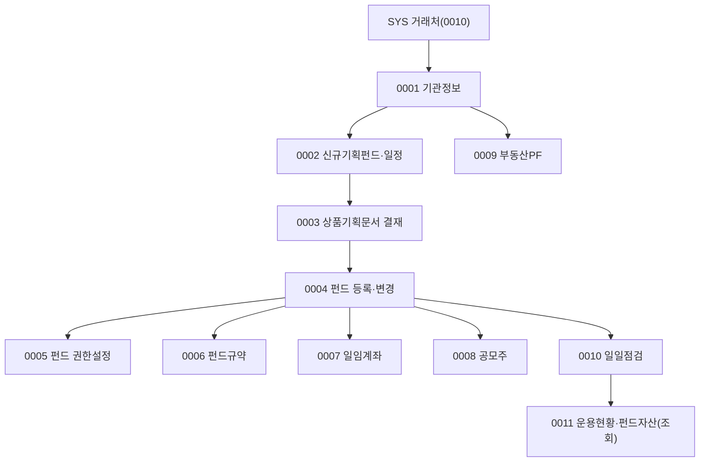

# FND 업무흐름 — 펀드관리

FND는 메뉴 `펀드관리`(42개) 전체를 묶는다. 소스 클래스는 `Fnd`(펀드)뿐 아니라 `Adv`(일임)·`Sch`(공모주 일정)·`Est`(부동산PF)·`Chk`(일일점검)·`Icam`(운용현황)·`Ast`(펀드자산)가 섞여 있다.
큰 줄기: ① 기관정보(수탁사·사무수탁사·수탁은행·발행기관) → ② 상품기획(신규기획펀드·일정·문서 결재) → ③ 펀드 등록·권한·규약 → ④ 일임계좌 → ⑤ 공모주 → ⑥ 부동산PF 용역 → ⑦ 일일점검 → ⑧ 운용현황·펀드자산(조회 중심).

## 화면번호 → 이벤트 (0001~0011 실행, 2026-11-13)

| 화면 | 이벤트 |
|:---|:---|
| #1051 수탁사 · #1052 사무수탁사 · #1100 수탁은행 · #1053 발행기관 | 0001 |
| #1046 신규기획펀드 등록 · #1047 신규기획펀드 권한 · #1105 기획일정 | 0002 |
| #1106 상품기획문서 | 0003 |
| #1048 펀드 등록·변경 | 0004 |
| #1050 펀드 권한설정 | 0005 |
| #1503 펀드규약 등록 · #1504 펀드규약 | 0006 |
| #1388 일임계좌 · #1389 일임 권한 · #1427 일임보유주식(타사무) · #1426 펀드보유주식(타사무) | 0007 |
| #1223 공모주 일정 · #1341 수요예측 · #1227 청약 운용지시 · #1290 참여계좌 | 0008 |
| #1375~#1378·#1382 부동산PF | 0009 |
| #1240~#1243 일일점검 | 0010 |
| #1049·#1327 펀드조회 · #1123·#1124 · #1475·#1268·#1323 운용현황 · #1117~#1129 펀드자산 | 0011 (조회) |

- kalpa에는 펀드관리 메뉴가 #1100 하나뿐이고 FND 데이터는 0이다(2026-11-13 확인). EMP처럼 API로 실행하거나, 필요하면 KFS #1076으로 메뉴를 연다(사용자 결정 필요).
- 미변환·제외: `Fnd01_Tab_FundSearchIcam`(#1099, 메뉴 사용안함), #1119·#1129·#1120(사용안함).
