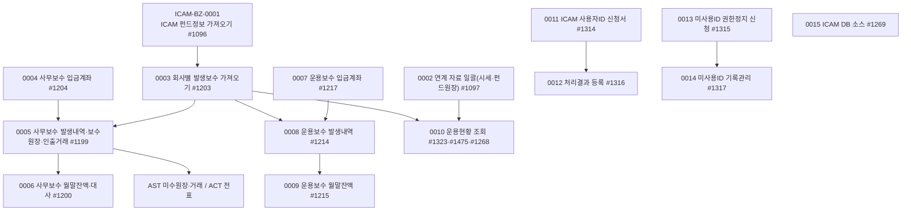

# ICAM 업무흐름 — ICAM 연계(펀드·보수·운용현황·ICAM 사용자ID)

ICAM은 KFS(한국펀드서비스)의 펀드 사무관리 시스템이다. AssetERP는 ICAM DB(운용 서버 `icam`, 자문 서버 `icam2`)를 읽어 펀드·보수·시세·펀드원장을 가져오고, 고객사(운용사·사무관리사)는 그것으로 보수를 관리한다.

1. **ADMIN(회사 0) 일괄 가져오기** — 펀드정보(0001), 시세·펀드원장 등 연계 자료(0002), 회사별 발생보수(0003). 회사마다 `sys01_icam_company_cd`(ICAM 회사코드)가 있어야 그 회사 자료가 온다.
2. **사무관리보수(사무관리사 — KFS 28000이 주 사용자)** — 펀드별 입금계좌(0004) → ICAM 발생내역 가져오기·보수원장·보수인출거래 생성(0005, AST 미수 원장 `ast30_book_fund_fee`·거래 `ast06_tr`·결제 `ast07_settle`·ACT 전표) → 월말잔액·ICAM 대사(0006).
3. **운용보수(운용사)** — 같은 구조: 입금계좌(0007) → 발생내역(0008) → 월말잔액(0009).
4. **운용현황 조회** — 펀드합계·기준가·발생보수(0010).
5. **ICAM 사용자ID 관리(KFS)** — 사용자ID 신청서 작성·상신(0011) → 처리결과 등록(0012), 미사용ID 권한정지 신청(엑셀·상신, 0013) → 기록관리(0014).
6. **ADMIN 보조** — ICAM DB 소스(함수·프로시저·트리거) 가져오기(0015).

ICAM 접속은 로컬에 없으므로 TOBE는 `asseterp.icam.mode=simulator`로 `data/icam-simulator/` CSV를 읽는다(가짜 자료). 가상 회사 kalpa·kova·igo에는 ICAM 메뉴가 없고 ICAM 회사코드도 없어 **ICAM 이벤트는 KFS(28000, 기본 계정 104)와 ADMIN(회사 0)에서 실행한다**(BIZ-BZ-0007~0011과 같은 방식). kalpa 사원 401은 권한 시험에만 쓴다.

## 1차 목록 (2026-11-14, 메뉴 23개 중 TOBE 화면 18개)

| ID | 사건 | 주요 화면 | 상태 |
|:---|:---|:---|:---|
| ICAM-BZ-0001 | ADMIN이 ICAM 펀드정보를 가져온다 | #1096 | 실행 |
| ICAM-BZ-0002 | ADMIN이 ICAM 연계 자료(정보코드·시세·펀드원장·공모주 등)를 일괄로 가져온다 | #1097 | 실행 |
| ICAM-BZ-0003 | ADMIN이 회사별 ICAM 발생보수를 가져온다 | #1203 | 실행 |
| ICAM-BZ-0004 | 사무관리사가 펀드별 사무보수 입금계좌를 등록한다 | #1204 | 실행 |
| ICAM-BZ-0005 | 사무관리사가 ICAM 사무보수 발생내역을 가져오고 보수원장·인출거래를 만든다 | #1199 | 실행 |
| ICAM-BZ-0006 | 사무관리사가 사무보수 월말잔액을 보고 ICAM과 대사한다 | #1200 | 실행 |
| ICAM-BZ-0007 | 운용사가 펀드별 운용보수 입금계좌를 관리한다 | #1217 | 실행 |
| ICAM-BZ-0008 | 운용사가 ICAM 운용보수 발생내역을 가져오고 본다 | #1214 | 실행 |
| ICAM-BZ-0009 | 운용사가 운용보수 월말잔액을 본다 | #1215 | 실행 |
| ICAM-BZ-0010 | 운용현황(펀드합계·기준가·발생보수)을 본다 | #1323, #1475, #1268·#1494 | 실행 |
| ICAM-BZ-0011 | KFS가 ICAM 사용자ID 신청서를 작성해 상신한다 | #1314 | 실행 |
| ICAM-BZ-0012 | KFS가 사용자ID 신청 처리결과를 등록한다 | #1316 | 실행 |
| ICAM-BZ-0013 | KFS가 미사용 사용자ID 권한정지 신청서를 올린다(엑셀·상신) | #1315 | |
| ICAM-BZ-0014 | KFS가 미사용ID 처리(삭제·정지해제) 기록을 관리한다 | #1317 | |
| ICAM-BZ-0015 | ADMIN이 ICAM DB 소스(함수·프로시저·트리거)를 가져와 본다 | #1269 | |

빼는 것: #1374 펀드예정일정보(`Icam00_Tab_FundExpectDate`, 변환하지 않음 U2-09), #1095·#1101·#1109·#1433(ICAM 연계정보구분·연계정보·관리자용·현금흐름, 변환대상 제외 — 로그인할 수 있는 회사에 메뉴 없음, `01e-변환목록.md` EE25~EE28).

## 화면번호 → 이벤트

| 화면 | 이벤트 |
|:---|:---|
| #1096 I/F > 10. ICAM > ICAM 펀드정보 | 0001 |
| #1097 I/F > 10. ICAM > 작업용 | 0002 |
| #1203 I/F > 10. ICAM > ICAM 보수(관리자용) | 0003 |
| #1204 관리회계 > 30. 사무보수관리 > 펀드별 보수입금계좌 등록 | 0004 |
| #1199 관리회계 > 30. 사무보수관리 > ICAM 펀드보수 발생내역 | 0005 |
| #1200 관리회계 > 30. 사무보수관리 > ICAM 펀드보수 월말잔액 | 0006 |
| #1217 관리회계 > 30. 펀드운용보수관리 > 운용보수 입금계좌 관리 | 0007 |
| #1214 관리회계 > 30. 펀드운용보수관리 > ICAM 운용보수 발생내역 | 0008 |
| #1215 관리회계 > 30. 펀드운용보수관리 > ICAM 운용보수 월말잔액 | 0009 |
| #1323 펀드관리 > 20. 운용현황 > 펀드운용현황(펀드합계) · #1475 펀드별 기준가 현황 · #1268 펀드별 발생보수현황 · #1494 관리회계 > 월별 펀드보수현황 | 0010 |
| #1314 KFS > 04. ICAM 사용자ID 관리 > 사용자ID 신청서 작성 | 0011 |
| #1316 KFS > 04. ICAM 사용자ID 관리 > 사용자ID 처리결과 등록 | 0012 |
| #1315 KFS > 04. ICAM 사용자ID 관리 > 미사용ID 권한정지 신청 | 0013 |
| #1317 KFS > 04. ICAM 사용자ID 관리 > 미사용ID 기록관리 | 0014 |
| #1269 I/F > 10. ICAM > ICAM DB Source Get | 0015 |

## 메뉴가 열린 회사 (2026-11-14 `sys03_company_menu`)

- 사무·운용보수(#1199·#1200·#1204·#1214·#1215·#1217): 10개 회사(KFS 28000, 한채투, 미래에셋, TDM자산운용 …).
- 운용현황(#1323·#1475·#1268)·사용자ID(#1314~#1317)·#1374: 5~6개 회사(KFS 28000 포함).
- #1096·#1097: ADMIN(0)·DEMO·PTR·TWO·TEST. #1203·#1269: ADMIN(0)만.
- kalpa·kova·igo: 없음.
