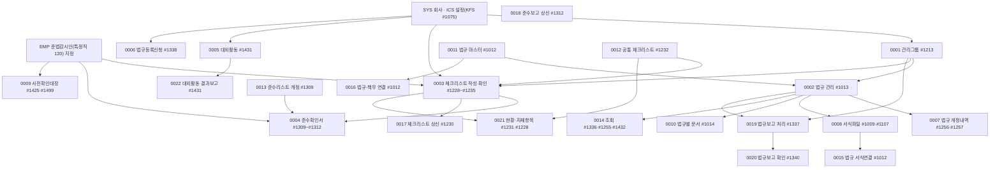

# ICS 업무흐름 — 내부통제(준법감시) (작성 중)

ICS는 회사가 지켜야 할 **법규**와 임직원의 **내부통제 준수**를 관리한다. 법규 마스터(`ics01_class_tree`, 회사 0 = KFS 관리)는 모든 회사가 공유하고, 회사는 **관리그룹**·**제외 설정**만 한다(0001~0002). 그 위에서 담당자가 주기마다 **체크리스트**에 답하고 확인자가 확인하며(0003), 임직원이 **준수확인서**를 써서 준법감시인이 점검·보고한다(0004). 대외활동은 결재(B15·B16)로 승인받고(0005), 법규가 목록에 없으면 신청해 KFS가 처리한다(0006). 법규가 개정되면 KFS가 개정내역을 알리고(0007), 보고 서식파일을 올려 회사가 내려받으며(0008), 광고·보도자료는 준법감시인이 사전확인(심사필번호)을 승인한다(0009). 법규별로 쓴 결재문서는 #1014에서 모아 본다(0010). 그 밑바탕인 법규 마스터(0011)·공통 체크리스트(0012)는 KFS가, 준수 문항 개정은 준법감시인이 한다(0013). 조회 화면 모음은 0014. 법규에 서식파일(0015)·책무 점검항목(0016)을 붙이는 것도 KFS가 하고, 체크리스트 확인(0017)과 준수보고(0018)는 결재(A27·A32)로 상신한다. 법규별 보고 마감은 담당 부서가 #1337에서 처리하고(0019) 부서장이 #1340에서 확인한다(0020). 준법감시인은 체크리스트 현황을 보고 회사 자체 항목을 더하며(0021), 대외활동은 끝난 뒤 결과보고(B16)를 결재받는다(0022). **준법감시인**은 EMP의 특정직 코드 `120`을 받은 사원이며, 확인·현황 목록의 전제다(0003).

## 화면번호 → 이벤트

| 화면 | 이벤트 |
|:---|:---|
| #1213 법규 관리그룹 등록 | 0001 |
| #1013 법규관리 · #1336 법규조회 · #1255 월별 법규조회 | 0002 (조회 화면은 읽기만) |
| #1228 체크리스트 관리 · #1229 작성 · #1230 확인(부서장) · #1231 현황 · #1235 상세 | 0003 |
| #1309 준수리스트 관리 · #1310 준수확인서 작성 · #1311 준수점검 · #1312 준수보고 | 0004 |
| #1431 대외활동신청 | 0005 |
| #1338 법규등록신청 (+KFS 관리) | 0006 |
| #1256 법규개정내역 (KFS 등록 #1257) | 0007 |
| #1009 법규보고 서식파일 (KFS 등록 #1107) | 0008 |
| #1425 준감인 사전확인대장 · #1499 심사필 확인대장 | 0009 |
| #1014 법규별 문서작성 | 0010 |
| #1012 법규관리(관리자) | 0011 |
| #1232 체크리스트(관리자) | 0012 |
| #1309 준수리스트 관리 (#1313 KFS용) | 0004(회사 사용)·0013(개정·확정) |
| #1336 법규조회 · #1255 월별 법규조회 · #1432 대외활동 신청내역 | 0014 |
| #1012 서식파일 · 책무점검항목 창 | 0015 · 0016 |
| #1230 [상신] | 0017 |
| #1312 [상신] | 0018 |
| #1337 법규보고 점검 | 0019 |
| #1340 법규보고 점검(관리자) | 0020 |
| #1231 현황 · #1235 상세 · #1228 편집창(법규 연결) | 0021 (0003·0017도 같은 화면 일부) |
| #1431 [결과보고 상신] | 0022 (신청은 0005) |
| `Ics36_Tab_InfoExchange`(정보교류) | 미변환(13-누락대장) |
