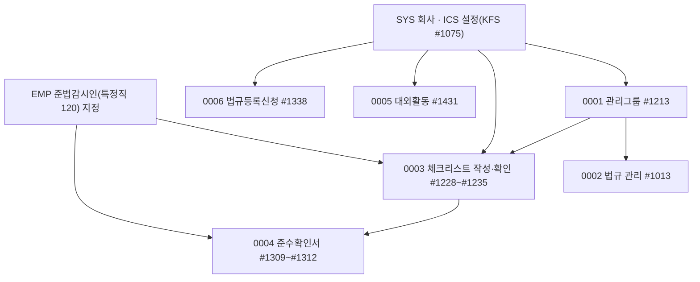

# ICS 업무흐름 — 내부통제(준법감시) (작성 중)

ICS는 회사가 지켜야 할 **법규**와 임직원의 **내부통제 준수**를 관리한다. 법규 마스터(`ics01_class_tree`, 회사 0 = KFS 관리)는 모든 회사가 공유하고, 회사는 **관리그룹**·**제외 설정**만 한다(0001~0002). 그 위에서 담당자가 주기마다 **체크리스트**에 답하고 확인자가 확인하며(0003), 임직원이 **준수확인서**를 써서 준법감시인이 점검·보고한다(0004). 대외활동은 결재(B15·B16)로 승인받고(0005), 법규가 목록에 없으면 신청해 KFS가 처리한다(0006). **준법감시인**은 EMP의 특정직 코드 `120`을 받은 사원이며, 확인·현황 목록의 전제다(0003).

## 화면번호 → 이벤트

| 화면 | 이벤트 |
|:---|:---|
| #1213 법규 관리그룹 등록 | 0001 |
| #1013 법규관리 · #1336 법규조회 · #1255 월별 법규조회 | 0002 (조회 화면은 읽기만) |
| #1228 체크리스트 관리 · #1229 작성 · #1230 확인(부서장) · #1231 현황 · #1235 상세 | 0003 |
| #1309 준수리스트 관리 · #1310 준수확인서 작성 · #1311 준수점검 · #1312 준수보고 | 0004 |
| #1431 대외활동신청 | 0005 |
| #1338 법규등록신청 (+KFS 관리) | 0006 |
| #1256 법규개정내역 · #1009 법규보고 서식파일 · #1014 법규별 문서작성 | 아직 (1차 목록) |
| #1425 준감인 사전확인대장 · #1499 심사필 확인대장 | 아직 (1차 목록, dcr 연계) |
| `Ics36_Tab_InfoExchange`(정보교류) | 미변환(13-누락대장) |
