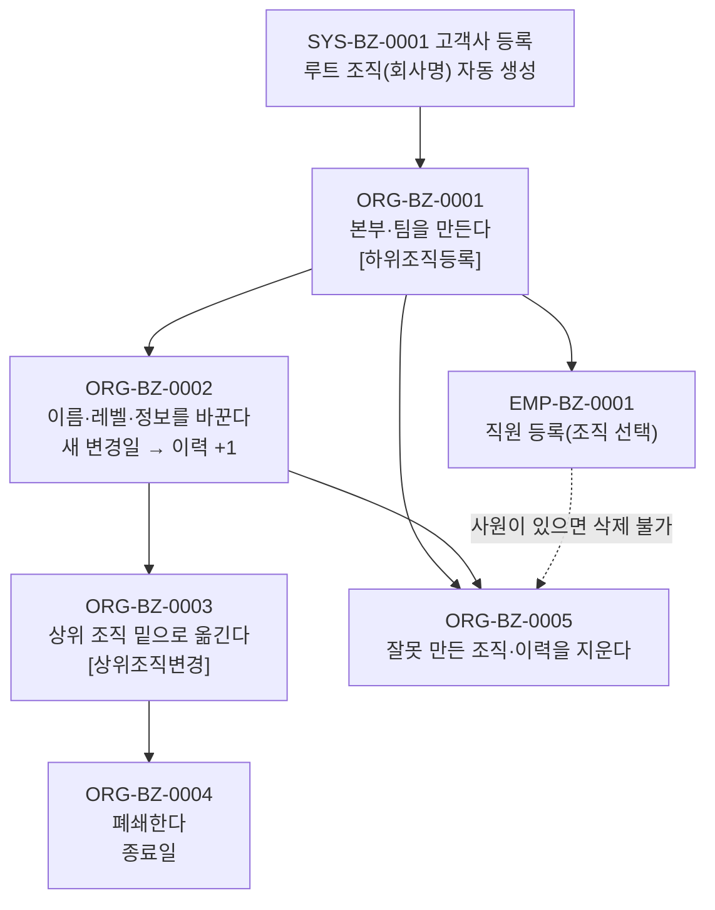

# ORG 업무흐름 — 조직

회사 이름 하나뿐인 루트 조직에서 시작해 **본부·팀을 아래로 만든다.** 직원은 반드시 조직 하나에 소속되므로(직원 등록의 필수 입력) **조직이 직원보다 먼저**다.

조직은 **코드(`org01_code`: 조직코드·개설·폐쇄) 한 줄 + 이력(`org02_info`: 이름·상위조직·레벨·정렬, 변경일마다 한 줄)**이다. 이름·소속을 바꿀 때 **변경일을 새로 적으면 이력이 쌓이고**, 기준일로 조회하면 그날의 조직도가 나온다. ORG 화면은 #1028 하나이고, 모든 이벤트가 그 화면의 창(조직 등록 · 조직정보 History · 상위조직 이동 · 사내 조직도)에서 일어난다.

## 상태가 바뀌는 것

| 무엇 | 값 | 바꾸는 이벤트 |
|:---|:---|:---|
| 조직 개설·폐쇄 | 개설일 → (종료일) | ORG-BZ-0001(개설), ORG-BZ-0004(폐쇄 — 종료일 다음 날부터 조회에서 빠짐) |
| 조직 이력 | 변경일마다 한 줄(이름·상위조직·레벨·정렬) | ORG-BZ-0002·0003(새 변경일이면 +1, 같으면 고쳐 씀), ORG-BZ-0005(한 줄 삭제) |
| 조직 구분(조직등급 코드 `0010` 회사 / `0020` 본부(실) / `0030` 팀 / `0090` 이사회) | 레벨 | ORG-BZ-0001·0002 |

## 화면번호 → 이벤트

| 화면 | 쓰는 이벤트 |
|:---|:---|
| #1028 경영관리 > 01. 조직 및 사원관리 > 조직정보 등록 (#1451 기본정보 쪽에도 같은 화면) | ORG-BZ-0001([하위조직등록]) · 0002~0005(행 두 번 누름 → "조직정보 History") · [조직도보기](조회만) |
| #1030 조직별 사원조회 | 결과 확인(EMP 등록 후) |

## TOBE에서 찾은 것 (2026-11-10)

| 무엇 | 이벤트 | 내용 | 할 일 |
|:---|:---|:---|:---|
| 책무점검 체크박스 없음 | ORG-BZ-0002 | 원본 편집 폼의 `책무점검`(`org02_tdm_yn`)이 TOBE 창·API에 없다. 원본 2026-04-15 추가 | 변경반영(체크박스·저장·조회 추가) |
| 삭제 검사 -3 없음 | ORG-BZ-0005 | 원본 2026-09-28 추가 "사용중인 조직은 삭제할 수 없습니다"(`f_check_use_org_id`). 그 함수가 asseterpdb에 없다 | 사용자 결정(함수 정의 확보) |
| 자기 자신을 상위로 고를 수 있음 | ORG-BZ-0003 | 원본도 같음. 저장하면 트리에서 사라진다 | 재설계 후보(막기) |

두 TOBE 부족 모두 `yunhee drift`에는 안 걸린다 — 기준(`docs/baseline.json`, 원본 `546a87d`)이 두 원본 커밋보다 뒤라 "변환 뒤 바뀐 것"이 아니다. 변환 때 빠진 것이다.
