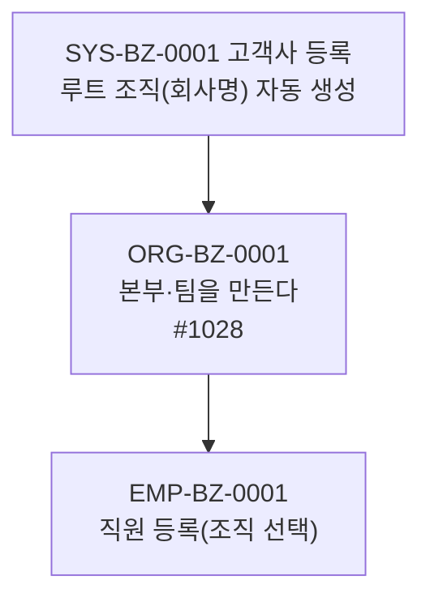

# ORG 업무흐름 — 조직

회사 이름 하나뿐인 루트 조직에서 시작해 **본부·팀을 아래로 만든다.** 직원은 반드시 조직 하나에 소속되므로(직원 등록의 필수 입력) **조직이 직원보다 먼저**다.

## 상태가 바뀌는 것

| 무엇 | 값 | 바꾸는 이벤트 |
|:---|:---|:---|
| 조직 개설·폐쇄 | 개설일 → (폐쇄일) | ORG-BZ-0001(개설), 폐쇄는 조직 수정 |
| 조직 구분(조직등급 코드 `0010` 회사 / `0020` 본부(실) / `0030` 팀 / `0090` 이사회) | 레벨 | ORG-BZ-0001 |

## 화면번호 → 이벤트

| 화면 | 쓰는 이벤트 |
|:---|:---|
| #1028 경영관리 > 01. 조직 및 사원관리 > 조직정보 등록 (#1451 기본정보 쪽에도 같은 화면) | ORG-BZ-0001 |
| #1030 조직별 사원조회 | 결과 확인(EMP 등록 후) |
