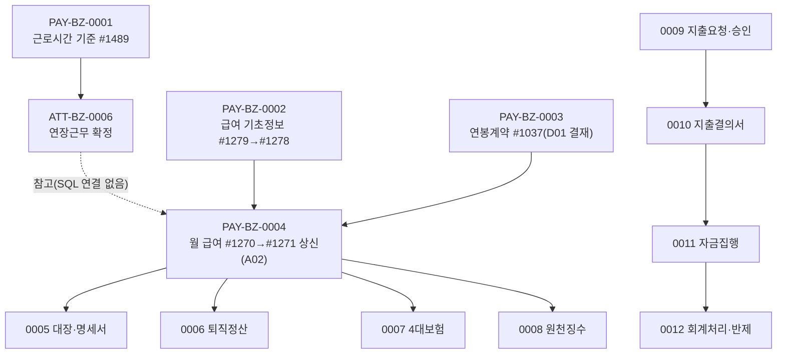

# PAY 업무흐름 — 급여·사업비

PAY는 두 갈래다. **급여**: KFS가 공통 기준(근로시간·세액표 등, 0001·0002)을 두고, 회사가 직원과 연봉계약(0003)을 맺은 뒤 매월 급여를 계산·확정하고(0004) 명세서·대장(0005), 퇴직정산(0006), 4대보험(0007), 원천징수(0008)로 이어진다. 근태의 연장근무 확정(ATT-BZ-0006)이 연장근로수당의 입력이다. **사업비**: 지출요청·부서장 승인(0009) → 지출결의서(0010) → 자금집행결의서(0011) → 회계처리·미지급반제(0012).

## 화면번호 → 이벤트

| 화면 | 이벤트 |
|:---|:---|
| #1489 근로시간기준관리 | 0001 |
| #1279 급여기초정보관리 · #1278 급여기초정보 | 0002 |
| #1037 연봉계약관리 · #1082 연봉계약현황 · #1104 연봉조회 | 0003 |
| #1270 급여관리 · #1281 급여관리(항목별) · #1285 급여항목조회 · #1271 급여대장 [상신] | 0004 |
| #1271 급여대장(조회·출력)·#1272·#1273 | 0005 |
| #1274 퇴직정산 (#1270 구분 03 생성) | 0006 |
| #1275·#1276 | 0007 |
| #1219·#1220·#1364 | 0008 |
| #1383·#1384 | 0009 |
| #1407·#1385 | 0010 |
| #1386·#1400 | 0011 |
| #1387·#1390·#1399 | 0012 |

옛 화면 7개(#1083~#1086·#1111·#1139·#1183, "(old)"·"(X)")는 TOBE 화면이 없어 뺐다.

## TOBE에서 찾은 것 (2026-11-12, 보안·버그 의심 #73~)

| 무엇 | 이벤트 | 내용 |
|:---|:---|:---|
| 근태 창이 근로시간 기준 적용일을 무시·시각 형식 검사 없음(#73) | 0001 | 원본도 같음 |
| 임금계산방법을 사원이 수정(#74) | 0002 | 서비스 주석과 다름 |
| 사원이 전 직원 연봉 조회·수정·삭제(#75, 상) | 0003 | 원본도 메뉴 권한뿐 |
| 근로일수를 회사 1 달력으로 셈(#76) | 0004 | TOBE만, 원본은 로그인 회사 |
| 사원이 전 직원 급여 조회·본인 급여 생성·수정·삭제(#77, 상) | 0004 | 원본도 메뉴 권한뿐 |
| 결재 완료 뒤 상신 행 결재 ID를 바꾸면 급여 잠금 해제(#78, 상) | 0004 | 원본도 화면 검사뿐 |
| 항목 일괄추가 중복(#79)·승인 API action 빠지면 반려(#80) | 0004 | |
| 사원이 남의 급여명세서 조회(#81, 상) | 0005 | 원본도 메뉴 권한뿐 |
| 결재 완료 뒤에도 퇴직정산 재생성·삭제(결재 연결 삭제)(#82, 상) | 0006 | 원본도 같음 |
| 연차휴가 탭 금액 ≠ 지급 연차수당(#83)·4대보험 정산 금액 NULL(#84) | 0006 | 원본 SQL·DB 함수 |
| 사원이 퇴직정산 조회·재계산(#85, 상) | 0006 | 원본도 메뉴 권한뿐 |
| 국민연금이 전년도 자료 없으면 NULL → 급여 공제 210 NULL(#86) | 0007 | DB 함수 |
| 사원이 본인 4대보험 정산액·보수월액 변경(#87, 상) | 0007 | 원본도 메뉴 권한뿐 |
| 파일 ID만으로 남·다른 회사 첨부 내려받기(#88, 상) | 0008 | 공통 파일 API |
| 사원이 남의 원천징수영수증을 자기에게 재지정(#89, 상)·확인서 결재 ID 바꿔 잠금 해제(#90) | 0008 | 원본도 메뉴 권한뿐 |
| 급여대장 [상신]마다 PDF 누적(#91) | 0004 | |
| 요청자가 자기 요청 승인(#92, 상)·승인 뒤 요청취소(#93)·pass로 부서장 승인 생략(#94, 상) | 0009 | 원본도 화면 검사뿐 |
| 미승인 지출을 완료 결의서에 붙여 자금집행 대상으로(#95)·화환 경로 승인 위조(#96)·완료 지출 금액 수정(#97)·사원이 급여 실지급액 조회(#98) — 모두 상 | 0010 | 원본도 같은 구조 |
| 예정내역 가져올 때 급여 금액 위조(#99)·완료 뒤 지급계좌 변경(#100) — 상 | 0011 | 원본도 같은 구조 |
| 사원이 사업비 전표 삭제·생성(#101, 상)·이미 전표 있는 지출로 이중 전표(#102)·분개맵핑 없으면 빈 전표가 성공(#103)·지급계좌 없는 자금집행은 미지급반제에 안 나옴(#104) | 0012 | 원본도 같음(#101·#102 메뉴 권한·화면 검사뿐, #103 DB 함수) |

## 다른 도메인이 먼저 있어야 하는 것 (0012)

- **ACT 회계 기초**: 회사마다 대표계정·실계정맵·거래유형별 분개맵핑(#1162)을 KFS가 [기초데이터생성]해야 사업비 전표에 분개가 생긴다. kalpa는 2026-11-12 회사 0 기준을 복사했다.
- **AST 회사 계좌**: 자금집행 지급계좌(`ast01_class_tree`)가 있어야 #1390 미지급반제에 나온다. kalpa에는 아직 없다(#1087 고유자산 기본등록).
