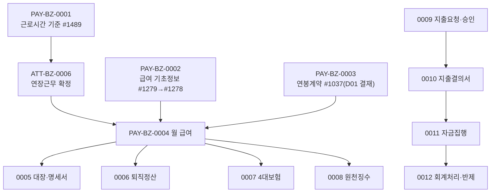

# PAY 업무흐름 — 급여·사업비 (작성 중)

PAY는 두 갈래다. **급여**: KFS가 공통 기준(근로시간·세액표 등, 0001·0002)을 두고, 회사가 직원과 연봉계약(0003)을 맺은 뒤 매월 급여를 계산·확정하고(0004) 명세서·대장(0005), 퇴직정산(0006), 4대보험(0007), 원천징수(0008)로 이어진다. 근태의 연장근무 확정(ATT-BZ-0006)이 연장근로수당의 입력이다. **사업비**: 지출요청·부서장 승인(0009) → 지출결의서(0010) → 자금집행결의서(0011) → 회계처리·미지급반제(0012).

## 화면번호 → 이벤트

| 화면 | 이벤트 |
|:---|:---|
| #1489 근로시간기준관리 | 0001 |
| #1279 급여기초정보관리 · #1278 급여기초정보 | 0002 |
| #1037 연봉계약관리 · #1082 연봉계약현황 · #1104 연봉조회 | 0003 |
| #1270·#1281·#1285 | 0004 |
| #1271·#1272·#1273 | 0005 |
| #1274 | 0006 |
| #1275·#1276 | 0007 |
| #1219·#1220·#1364 | 0008 |
| #1383·#1384 | 0009 |
| #1407·#1385 | 0010 |
| #1386·#1400 | 0011 |
| #1387·#1390·#1399 | 0012 |

옛 화면 7개(#1083~#1086·#1111·#1139·#1183, "(old)"·"(X)")는 TOBE 화면이 없어 뺐다.

## TOBE에서 찾은 것 (2026-11-12, 보안·버그 의심 #73~)

| 무엇 | 이벤트 | 내용 |
|:---|:---|:---|
| 근태 창이 근로시간 기준 적용일을 무시·시각 형식 검사 없음(#73) | 0001 | 원본도 같음 |
| 임금계산방법을 사원이 수정(#74) | 0002 | 서비스 주석과 다름 |
| 사원이 전 직원 연봉 조회·수정·삭제(#75, 상) | 0003 | 원본도 메뉴 권한뿐 |
