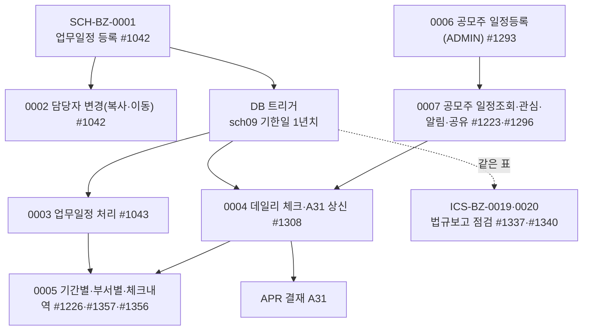

# SCH 업무흐름 — 업무일정(스케줄)·데일리 체크·공모주 일정

SCH는 직원 한 사람 한 사람의 **업무일정(할 일 달력)**과, KFS가 모든 회사에 올려 주는 **공모주 일정**을 다룬다. 법규 점검 일정(법규보고 점검 #1337·#1340)도 같은 표(`sch03_deadline`·`sch04_list`)를 쓰지만 그건 ICS(ICS-BZ-0019·0020)에서 했다.

1. **업무일정 등록(0001)** — 직원이 분류(`sch08_class`, 사람별)를 만들고 일정(`sch01_info`)을 등록한다. 일정마다 기한 조건을 붙인다: 일회성(지정일)·반복주기(매월 N일, 매일 …)(`sch03_deadline`). 기한을 넣으면 **DB 트리거가 앞으로 1년치 기한일**(`sch09_deadline_day`)을 만든다. 공유자(`sch02_share`)·알람(`sch06_alarm`)·첨부·연관법규(`sch05_relate_ics`)도 붙인다.
2. **담당자 변경(0002)** — 내 일정을 다른 직원에게 복사하거나 넘긴다(분류·기한·공유·알람·법규·첨부까지 복사).
3. **처리(0003)** — 기한일이 된 일정을 #1043에서 완료·해당없음으로 처리한다(`sch04_list`에 처음 저장할 때 행이 생긴다 — 그 전에는 조회 SQL이 만들어 보여 주는 가상 행).
4. **데일리 체크(0004)** — '데일리' 표시한 매일 일정과 나에게 공유된 공모주 일정을 #1308에서 체크하고 **A31 결재**로 올린다.
5. **조회(0005)** — 기간별(#1226)·부서별(#1357)·체크내역(#1356).
6. **공모주 일정(0006·0007)** — ADMIN(회사 0)이 #1293에서 공모주 일정(`sch10_ipo`)을 등록·엑셀 업로드하고 주간사·종목코드매칭·미일치를 관리한다. 회사 직원은 #1223·#1296에서 보고 관심종목·알림(`sch11_ipo_company`)·공유자를 정한다. 공유받은 직원의 데일리 체크(0004)에 `[수요예측] 종목명`처럼 뜬다.



## 1차 목록 (2026-11-14, 메뉴 15개 중 TOBE 화면 11개)

| ID | 사건 | 주요 화면 | 상태 |
|:---|:---|:---|:---|
| SCH-BZ-0001 | 직원이 업무일정을 등록한다(분류·기한·공유·알람) | #1042 | 실행 |
| SCH-BZ-0002 | 업무일정 담당자를 바꾼다(복사·이동) | #1042 [담당자 변경] | 실행 |
| SCH-BZ-0003 | 기한이 된 업무일정을 처리한다 | #1043 | 실행 |
| SCH-BZ-0004 | 데일리 체크리스트를 체크하고 결재(A31)받는다 | #1308 | 실행 |
| SCH-BZ-0005 | 업무일정·체크내역을 본다 | #1226, #1357, #1356 | 실행 |
| SCH-BZ-0006 | ADMIN이 공모주 일정을 등록한다(엑셀·주간사·종목매칭·미일치) | #1293 | 실행 |
| SCH-BZ-0007 | 직원이 공모주 일정을 보고 관심·알림·공유자를 정한다 | #1223, #1296 | 실행 |

빼는 것: #1015 법규 담당자 변경(일회성)·#1440 (X)기간별 스케줄 조회·#1441 (X)체크리스트 생성(메뉴 사용 안 함, TOBE 화면 없음), #1017 법규통제 상세내역(사용X 그룹, 13-누락대장 제외). #1337·#1340은 ICS-BZ-0019·0020, #1223의 수요예측·청약 지시는 FND-BZ-0008.

## 화면번호 → 이벤트

| 화면 | 이벤트 |
|:---|:---|
| #1042 스케줄 > 01. 업무일정 > 업무일정 등록 | 0001, 0002 |
| #1043 스케줄 > 01. 업무일정 > 업무일정 처리 | 0003 |
| #1308 스케줄 > 02. 업무일정 체크 > 데일리 체크리스트(상신) | 0004 |
| #1226 기간별 업무일정 조회 · #1357 부서별 업무일정 조회 · #1356 업무일정 체크내역 | 0005 |
| #1293 기초자료 > 30. 자산&경영 > 공모주 일정등록 | 0006 |
| #1223 펀드관리 > 04. 공모주청약 > 공모주 일정조회 · #1296 고유자산 > 20. 고유자산 거래처리 > 공모주일정 | 0007 (FND-BZ-0008) |
| #1337·#1340 준법감시 > 법규보고 점검(관리자) | ICS-BZ-0019·0020 |

## 메뉴가 열린 회사 (2026-11-14 `sys03_company_menu`)

- 업무일정 #1042 11곳·#1043 9곳·#1226·#1356·#1357 4곳·#1308 5곳(KFS 28000 포함). 공모주 #1223 10곳·#1296 5곳. #1293은 ADMIN(0)만.
- kalpa: 없음 — **API로 실행**(EMP·ATT처럼). 김사원 401·최사원 402·김과장 301, 공모주 일정등록은 ADMIN `admin/admin/1111`.

## 시작 점검 (2026-11-14 `yunhee biz-endpoints sch`)

API 79개 중 검사 `⚠없음` 18개: 공모주 조회(`GET ipos`·`ipos/{id}`·`ipos/template`·`ipo-corps*`·`ipo-item-matchings` — KFS 공통 자료라 읽기만), `GET deadlines/{id}`·`deadlines/templates`, **연관법규 `GET·POST·DELETE relate-ics`**(⚠#248), 엑셀 내려받기 2개, `classes/{id}/check-delete`·`write-groups/{id}/in-use`·`write-groups/shares/check-delete`. 쓰기 API는 대부분 '회사'만 본다 — 같은 회사 남의 일정·처리결과를 바꾼다(⚠#247·#249).

## 남긴 것 · 정리 (2026-11-14)

- 남김(kalpa): 401 분류 `ZZ 정기업무`(`202611149151501`), 일정 `월말 경비 정산 제출`(`…502`, 월별 10일 `…503`·수시 11-20 `…519`, 공유 김과장 `…520`, 알람 `…521`), 매일 일정 `출근 후 메일·결재함 확인`(`…552`, 기한 `…553`), 처리 `sch04` 3행(`…548` 11-10 완료, `…556`·`…557` 11-16 데일리), A31 결재 완료 `202611149151559`, kalpa A31 문서분류 → `보고 및 공시/업무보고서/업무보고서`(`202611109047230`). 출력 자료 `sys99_print` +5(그룹 `…579`).
- 지움: 402 복사 일정(`…528`), 시험 공모주 2건·주간사·종목매칭(ADMIN), 연관법규 시험 1행.
- 고아로 남은 것(정리 SQL 대기 — #247·#253): 402 복사 일정의 분류 `…527`·공유 `…529`·기한 `…530`·`…531`(기한일 15)·알람 `…547`, 공모주 `sch11` `…574`·`…575`·공유 `…578`.

```sql
-- 먼저 tools/db_dump_backup.sh
DELETE FROM sch09_deadline_day WHERE sch09_deadline_id IN (202611149151530, 202611149151531);
DELETE FROM sch03_deadline     WHERE sch03_deadline_id IN (202611149151530, 202611149151531);
DELETE FROM sch02_share        WHERE sch02_share_id    IN (202611149151529, 202611149151578);
DELETE FROM sch06_alarm        WHERE sch06_alarm_id    = 202611149151547;
DELETE FROM sch08_class        WHERE sch08_class_id    = 202611149151527;
DELETE FROM sch11_ipo_company  WHERE sch11_ipo_company_id IN (202611149151574, 202611149151575);
```
