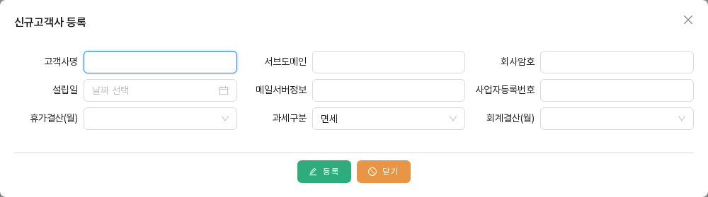
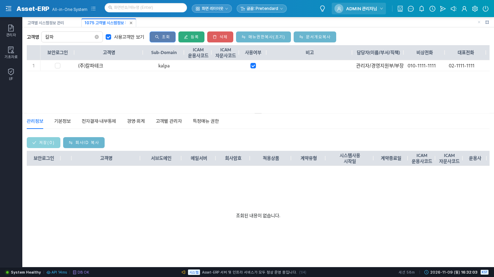

# SYS-BZ-0001 새 회사가 고객이 된다 (고객사 등록)

> **한 줄 요약** — (주)칼파테크가 AssetERP를 쓰기로 계약했다. KFS 관리자가 칼파테크를 고객사로 등록하고, 칼파테크 전용 주소 `kalpa`를 연다.

| 항목 | 내용 |
|:---|:---|
| 누가 | KFS 관리자 — 로그인 `admin/admin/1111` (http://admin.localhost:8082/AssetERP) |
| 언제 | 고객사와 계약했을 때 한 번 |
| 먼저 있어야 하는 것 | 없음(첫 이벤트) |
| 다음 이벤트 | SYS-BZ-0002 고객사 관리자 발급 → SYS-BZ-0003 메뉴 열어 주기 ([목록](../README.md)) |
| 실제 실행 | kalpa, 2026-11-09 (회사 ID 202611099192858, 2026-11-09 규칙 확정 뒤 다시 만듦 — 문서 아래 행 수는 이 실행 값) |

## 따라 하기

| 단계 | 누가 | 화면 | 누르는 것 · 입력하는 것 | 화면에 보이는 결과 |
|:---:|:---|:---|:---|:---|
| 1 | KFS 관리자 `admin/admin/1111` | **#1075** 관리자 > 01. 고객관리 > 고객별 시스템정보 관리 | [등록] → "신규고객사 등록" 창에 고객사명 `(주)칼파테크`, 서브도메인 `kalpa`, 회사암호 `1111`, 설립일 `2020-03-02`, 사업자등록번호 `220-81-11111`, 휴가결산(월) `12`, 과세구분 `공통`, 회계결산(월) `12` → [등록] → "해당 신규 고객사를 등록하시겠습니까?" [예] | 창이 닫히고 고객 목록에 칼파테크가 생긴다. **사용여부는 꺼져 있다** |
| 2 | 〃 | #1075 | 고객 목록에서 **칼파테크 행을 클릭** → 아래 [관리정보] 탭 | 행을 클릭해야 아래 탭에 그 회사 정보가 나온다(안 누르면 "조회된 내용이 없습니다") |
| 3 | 〃 | #1075 [관리정보] 탭 | 적용상품 `K-책무 A1`, 계약유형, 시스템사용 시작일, 운용사 체크(자산운용사), **사용여부 체크** → [저장] | 목록의 사용여부에 체크가 생긴다. 이제 `kalpa` 주소로 로그인할 수 있다(로그인할 계정은 SYS-BZ-0002에서 만든다) |
| 4 | 〃 | #1075 [기본정보] 탭 | 법인등록번호, 담당자, 전화, 이메일, 주소 → [저장] | 목록의 담당자·대표전화·주소 칸이 채워진다 |
| 5 | 〃 (선택) | #1075 | 칼파테크 행 선택 → [문서개요복사] → [예] | "문서분류의 개요가 복사완료되었습니다" — 문서분류 트리의 설명(개요)이 표준(회사 0)에서 복사된다 |

그림 — 단계 1 "신규고객사 등록" 창:



그림 — 단계 3 뒤 고객 목록(사용여부 체크). 아래 탭이 빈 것은 **행을 아직 클릭하지 않아서**다:



## DB에 남는 것

단계 1 [등록] 한 번으로 회사 행과 함께 **회사 초기화**가 일어난다. 표준 회사(회사 0, `admin`)의 기준 데이터를 새 회사로 복사하는 것이다.

| 테이블 | 무엇 | 추가/수정 | kalpa에서 생긴 행 |
|:---|:---|:---|---:|
| `sys01_company` | 고객사 | 추가(단계 1), 수정(단계 3·4) | 1 |
| `org01_code` · `org02_info` | 조직 최상단(회사 이름의 루트 조직) | 추가 | 1 · 1 |
| `sys09_code` | 회사별 공통코드(직위·직책 등) | 추가 | 208 |
| `dcr01_class_tree` | 문서분류 트리 | 추가(단계 1), 수정(단계 5 개요 204건) | 622 |
| `act01_account_code` | 계정과목 | 추가 | 907 |
| `sys30_leave_year` | 연차휴가 기준 | 추가 | 23 |
| `ics30_compliance` · `ics33_compliance_answer` | 임직원 준수확인 문항·답 | 추가 | 10 · 12 |
| `ast02_detail` | 자산 상세 항목 | 추가 | 6 |
| `ics02_manager` | 내부통제 관리자 자리 | 추가 | 1 |
| `pay04`·`bbs12`·`pay51`·`com11` | 급여산식·신청서식·지출서식·양식맵핑 | 추가 | 0 (표준 회사에 원본이 없음) |

이 단계에서 **생기지 않는 것**: 회사 메뉴(`sys03_company_menu`, SYS-BZ-0003), 고객사 관리자(`sys02_user`, SYS-BZ-0002), 직원(EMP).

## 결과를 볼 수 있는 화면

- #1075 고객 목록(조회 줄의 "사용고객만 보기"가 체크돼 있으면 사용여부를 켠 회사만 나온다), #1076 회사별 메뉴맵핑의 고객 목록(사용 고객만 나옴 → **단계 3을 해야 #1076에서 칼파테크를 고를 수 있다**)
- 회사 초기화 결과는 칼파테크 관리자로 로그인한 뒤(SYS-BZ-0002·0003 이후) 고객사 공통코드(#1079), 문서분류, 계정과목 화면에서 보인다.

## 업무 규칙 · 주의

- 필수: 고객사명·서브도메인·회사암호·설립일·사업자등록번호. 빠지면 "○○은 필수 입력항목입니다."
- 서브도메인 = 회사 코드 = 로그인 주소. 다른 회사와 겹치면 "이미 사용 중인 서브도메인입니다." (TOBE에서 추가한 검사 — AS-IS는 막지 않았다)
- 사업자등록번호가 겹치면 "이미 등록된 사업자등록번호입니다." (AS-IS는 DB 오류 원문을 보여 줬다)
- **사용여부를 켜지 않으면 그 회사로 로그인할 수 없다.** 등록 직후에는 꺼져 있다.
- #1075는 위 목록에서 회사 행을 클릭해야 아래 탭들이 채워진다.

## 다음 이벤트

SYS-BZ-0002 고객사 관리자 발급(#1075 [고객별 관리자] 탭) → SYS-BZ-0003 메뉴 열어 주기(#1076).
둘 다 하기 전에는 `kalpa` 주소로 로그인해도 계정이 없거나(0002 전) 메뉴가 비어 있다(0003 전).

<details>
<summary>시나리오 데이터 (자동 시험용)</summary>

```yaml
id: SYS-BZ-0001
needs: []
actor: { company: admin, user: admin, password: "1111" }
steps:
  - no: 1
    screen: 1075
    action: '[등록] → "신규고객사 등록" [등록] → [예]'
    api: POST /api/v1/sys/companies
    body: { companyNm: "(주)칼파테크", locNm: kalpa, emgrcyPasswd: "1111", startDate: "2020-03-02",
            bizNo: "220-81-11111", leaveMonthCd: "12", taxType: "3", accountCloseMonth: "12" }
  - no: 3
    screen: 1075
    action: '[관리정보] 사용여부 체크 → [저장]'
    api: PUT /api/v1/sys/companies/{companyId}/manage
    body: { erpProductCd: A1, contType: "가상회사(업무분석)", noticeDate: "2026-11-09", assetYn: "true", useYn: "true" }
  - no: 4
    screen: 1075
    action: '[기본정보] → [저장]'
    api: PUT /api/v1/sys/companies/{companyId}/basic
  - no: 5
    screen: 1075
    action: '[문서개요복사] → [예]'
    api: POST /api/v1/dcr/class-trees/comments/copy/{companyId}
expect:
  - { table: sys01_company, op: insert, where: "sys01_loc_nm = 'kalpa'", then: "sys01_use_yn = 'true'" }
  - { table: org01_code, op: insert, rows: 1 }
  - { table: sys09_code, op: insert, rows: ">0" }
  - { table: dcr01_class_tree, op: insert, rows: ">0" }
  - { table: act01_account_code, op: insert, rows: ">0" }
  - { table: sys03_company_menu, rows: 0 }   # 메뉴는 SYS-BZ-0003
  - { table: sys02_user, rows: 0 }           # 관리자는 SYS-BZ-0002
test: backend/src/test/java/kr/co/kfs/asseterp/biz/scenario/SysBz0001ScenarioTest.java
```
</details>

<details>
<summary>확인 SQL</summary>

```sql
-- 회사와 사용여부
select sys01_company_id, sys01_company_nm, sys01_loc_nm, sys01_use_yn, sys01_erp_product_cd
  from sys01_company where sys01_loc_nm = 'kalpa';
-- 회사 초기화로 생긴 행
select 'sys09_code' t, count(*) from sys09_code where sys09_company_id = :cid
union all select 'dcr01_class_tree', count(*) from dcr01_class_tree where dcr01_company_id = :cid
union all select 'act01_account_code', count(*) from act01_account_code where act01_company_id = :cid
union all select 'org01_code', count(*) from org01_code where org01_company_id = :cid;
```
</details>

<details>
<summary>근거 (AS-IS · TOBE)</summary>

- AS-IS 화면: `Sys01_Tab_Company`(목록·[등록] E3·[문서개요복사] E6), 등록 창 `Sys01_Edit_Company`(필수 검사 `updateChk` L180-222), 탭 `Sys01_TabPage_Info01`(관리정보)·`Info02`(기본정보)
- AS-IS 서버: `sys.Sys01_Company.update` L165-181, 회사 초기화 `UpdateDataModel` L90-224("ASP용으로 회사가 추가되면 관련된 DATA를 insert" 1~15번), 문서개요 `dcr.Dcr01_ClassTree.commentInsert`
- TOBE: `SysCompanyService.createCompany`·`initCompany`·`updateCompanyManage`·`updateCompanyBasic`, API `POST /api/v1/sys/companies` 등(위 yaml)
- TOBE 상태(2026-11-09): **OK** — kalpa로 API 실행, 서버 오류 없음. 시나리오 시험 3개 통과(`yunhee run "gradle test --tests '*SysBz0001*'"`).
- 참고: `1-변환/09-업무흐름.md` 1절(실제 운영 로그 kova 기준 순서)
</details>
