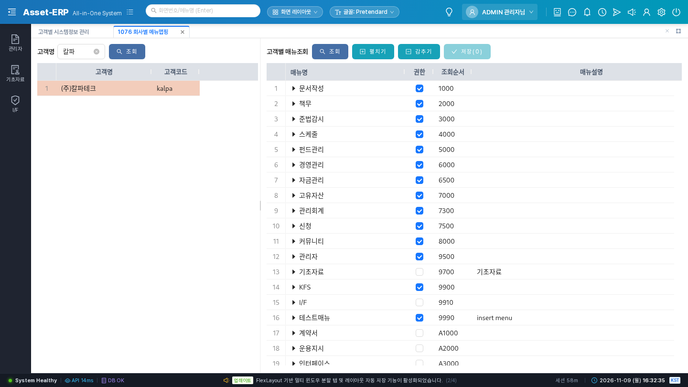
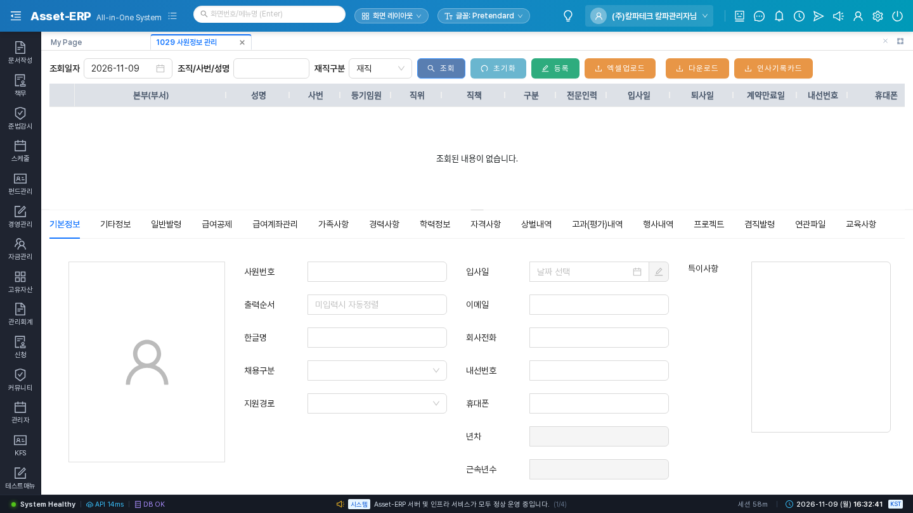

# SYS-BZ-0003 고객사가 쓸 메뉴를 열어 준다

> **한 줄 요약** — 칼파테크 관리자 계정은 만들었지만 로그인해도 메뉴가 비어 있다. KFS 관리자가 표준으로 쓰는 회사(출발지, 예: `kfstest`)의 메뉴 권한을 칼파테크(도착지)로 **통째로 복사**해 칼파테크가 쓸 메뉴를 열어 준다.

| 항목 | 내용 |
|:---|:---|
| 누가 | KFS 관리자 — 로그인 `admin/admin/1111` |
| 언제 | 고객사 등록 때 한 번, 계약 상품이 바뀌어 메뉴를 더하거나 뺄 때 |
| 먼저 있어야 하는 것 | SYS-BZ-0001 (회사 행). 관리자 로그인 확인은 SYS-BZ-0002 |
| 다음 이벤트 | SYS-BZ-0004 권한그룹 만들기 / ORG 조직 입력 ([목록](../README.md)) |

## 따라 하기 — 주 경로: #1075 [매뉴권한복사(초기)]

| 단계 | 누가 | 화면 | 누르는 것 · 입력하는 것 | 화면에 보이는 결과 |
|:---:|:---|:---|:---|:---|
| 1 | KFS 관리자 | **#1075** 관리자 > 01. 고객관리 > 고객별 시스템정보 관리 | 툴바 **[매뉴권한복사(초기)]** | "매뉴권한복사(초기)" 창 |
| 2 | 〃 | 같은 창 | 출발지 `kfstest`(표준으로 쓰는 회사), 도착지 `(주)칼파테크` 선택 → [복사] | "[ 출발지 ] 의 메뉴권한을 [ 도착지 ] 으로 복사하시겠습니까?" |
| 3 | 〃 | 〃 | [예] | 창이 닫히고 복사가 끝난다 |
| 4 | 〃 | **#1076** 회사별 메뉴맵핑 | 왼쪽 고객 목록에서 칼파테크 클릭 | 오른쪽 트리에 메뉴와 "권한" 체크가 보인다 |

그림 — 단계 4 #1076 칼파테크의 메뉴 트리:



그림 — 복사 뒤 `kalpa/admin/1111`로 로그인한 화면(메뉴가 보인다):



## 따라 하기 — 대안: #1076에서 하나씩 체크

메뉴를 골라 열거나 닫을 때 쓴다(계약 상품 변경 등).

| 단계 | 화면 | 하는 것 | 결과 |
|:---:|:---|:---|:---|
| 1 | **#1076** 회사별 메뉴맵핑 | 고객 목록에서 칼파테크 클릭 → 트리에서 "권한" 체크/해제 → [저장] | 켠 메뉴는 부모 메뉴도 같이 켜지고, 끈 메뉴는 자식 메뉴도 꺼진다 |

(메뉴 하나를 여러 회사에 주려면 #1077 메뉴 관리.)

## DB에 남는 것

| 테이블 | 무엇 | 추가/수정 | 행 |
|:---|:---|:---|---:|
| `sys03_company_menu` | 회사가 쓸 수 있는 메뉴 | 추가 | 출발지와 같은 수(2026-11-09 kfstest 656) |
| `sys04_role` | 권한그룹 | 추가 | 출발지와 같은 수(kfstest 11) |
| `sys07_role_menu` | 권한그룹별 메뉴 | 추가 | 출발지 권한그룹의 메뉴 수만큼(kfstest 1,272) |

- 회사 메뉴·권한그룹 메뉴는 도착지에 **이미 있으면 건너뛴다**.
- 권한그룹(`sys04_role`)은 **중복 검사 없이 전부 복사**한다 → **같은 복사를 두 번 하면 권한그룹이 두 벌**이 된다(AS-IS 그대로).
- 이 단계에서 생기지 않는 것: 직원(EMP), 직원별 권한그룹(`sys05_user_role`, SYS-BZ-0006).

## 결과를 볼 수 있는 화면

- #1076 칼파테크 트리, #1284 메뉴별 그룹권한(View), 칼파테크 관리자 로그인 후 왼쪽 메뉴.
- 복사만으로 직원이 메뉴를 보지는 못한다 — 직원은 권한그룹(0004~0006)이 필요하다.

## 업무 규칙 · 주의

- 출발지·도착지 모두 필수: "출발지 값은 필수입력 항목입니다" / "도착지 값은 필수입력 항목입니다".
- **KFS 관리자만** 할 수 있다.
- **한 번만 한다.** 다시 하면 권한그룹이 두 벌이 된다. 메뉴만 더하려면 #1076에서 체크한다.
- 출발지가 표준이다 — 출발지 회사의 메뉴·권한그룹 구성이 그대로 따라온다.

## 다음 이벤트

회사 안에서 직위·조직이 필요하면 ORG(조직 입력), 직원 권한은 SYS-BZ-0004 → 0005 → 0006(EMP 직원 등록 필요).

<details>
<summary>시나리오 데이터 (자동 시험용)</summary>

```yaml
id: SYS-BZ-0003
needs: [SYS-BZ-0001]
actor: { company: admin, user: admin, password: "1111" }
steps:
  - no: 3
    screen: 1075
    action: '[매뉴권한복사(초기)] 출발지 kfstest → 도착지 칼파테크 → [복사] → [예]'
    api: POST /api/v1/sys/company-menus/copy
    body: { outPut: "<kfstest 회사ID>", inPut: "<칼파테크 회사ID>" }
expect:
  - { table: sys03_company_menu, op: insert, rows: "= 출발지 행 수" }
  - { table: sys04_role, op: insert, rows: "= 출발지 행 수" }
  - { table: sys07_role_menu, op: insert, rows: ">0" }
rules:
  - 같은 복사를 두 번 → 회사 메뉴 그대로, sys04_role 두 배
  - 출발지·도착지 null → "출발지 값은 필수입력 항목입니다" / "도착지 …"
test: backend/src/test/java/kr/co/kfs/asseterp/biz/scenario/SysBz0003ScenarioTest.java
```
</details>

<details>
<summary>확인 SQL</summary>

```sql
select 'sys03_company_menu' t, count(*) from sys03_company_menu where sys03_company_id = :cid
union all select 'sys04_role', count(*) from sys04_role where sys04_company_id = :cid
union all select 'sys07_role_menu', count(*) from sys07_role_menu rm join sys04_role r on r.sys04_role_id = rm.sys07_role_id
 where r.sys04_company_id = :cid;
```
</details>

<details>
<summary>근거 (AS-IS · TOBE)</summary>

- AS-IS 화면: `Sys01_Tab_Company` 툴바 copyMenuButton → `Sys03_Lookup_CompanyMenu`(출발지·도착지 콤보, [복사] `insertCheck` L78-107, `insert` L109-127), `Sys03_Tab_CompanyMenu`·`Sys03_Tree_CompanyMenu`(#1076, [저장] `update` L249-270)
- AS-IS 서버: `sys.Sys03_CompanyMenu.insert` L21-84(회사메뉴 → 권한그룹 `sys04_role.copyRole` → 권한그룹메뉴), `sys.Sys06_Menu.updateCompanyMenu` L345
- TOBE: `POST /api/v1/sys/company-menus/copy`, `SysCompanyMenuService.copyMenus`
- TOBE 상태(2026-11-09): **OK** — 시나리오 시험 3개 통과(`yunhee run "gradle test --tests '*SysBz0003*'"`). 그림 2장은 이전 kalpa 실행 때 찍은 것.
- ⚠ 이 세션에서 API 재실행은 못 했다(KFS `admin` 비밀번호 초기화 상태). 회사 수는 2026-11-09 asseterpdb의 kfstest 값이며 바뀔 수 있다.
</details>
