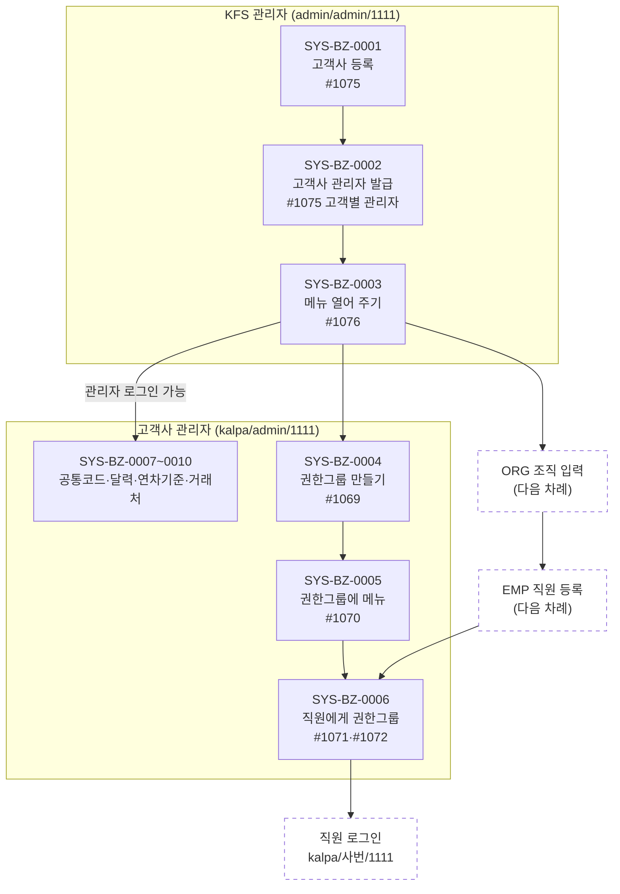

# SYS 업무흐름 — 시스템관리

SYS는 **회사를 열고(고객사·관리자·메뉴), 누가 무엇을 볼지 정하고(권한), 공통 기준을 갖추는** 도메인이다.
등장인물은 둘이다: **KFS 관리자**(AssetERP를 파는 회사, `admin` 서브도메인)와 **고객사 관리자**(예: kalpa의 `admin`).

## 흐름도

- 굵은 줄기: **0001 → 0002 → 0003**까지 하면 고객사 관리자가 로그인해서 메뉴를 본다(kalpa로 실제 확인, 2026-11-09).
- 직원이 메뉴를 보려면 **0004 → 0005 → 0006**과 EMP 직원 등록이 모두 있어야 한다. 기본권한(default_role) 그룹을 쓰면 0006은 건너뛸 수 있다.
- 그 밖의 SYS 이벤트(0011 특정화면 요청·승인, 0013 오류 통보·처리, 0014~0021 KFS 운영)는 흐름 밖에서 필요할 때 일어난다.

## 상태가 바뀌는 것

| 무엇 | 값 | 바꾸는 이벤트 | 뜻 |
|:---|:---|:---|:---|
| 회사 사용여부 `sys01_use_yn` | 없음 → `true` | SYS-BZ-0001 단계 3(관리정보 탭) | `true`가 아니면 그 서브도메인 로그인 불가 |
| 회사 메뉴 `sys03_use_yn` | 없음 → `true` / `false` | SYS-BZ-0003 | 켜면 부모 메뉴도 켜지고, 끄면 자식 메뉴도 꺼진다 |
| 관리자 전체권한 `sys02_admin_yn` | `true`/`false` | SYS-BZ-0002 | `false`면 그 관리자에게 체크한 메뉴(#1075 매뉴권한 팝업)만 보인다 |

## 화면번호 → 이벤트

| 화면 | 쓰는 이벤트 |
|:---|:---|
| #1075 고객별 시스템정보 관리 | 0001(등록·관리정보·기본정보·문서개요복사), 0002(고객별 관리자 탭), 0003 대안(매뉴권한복사(초기)), 0017(공인IP) |
| #1076 회사별 메뉴맵핑 | 0003 |
| #1077 메뉴 관리 | 0014, 0003 대안(메뉴 하나를 여러 회사에) |
| #1069 권한그룹 관리 / #1112 (KFS) | 0004 |
| #1070 권한그룹별 메뉴 맵핑 / #1286·#1247 (KFS) | 0005 |
| #1071 권한그룹별 사용자 맵핑 / #1072 사용자별 권한그룹 맵핑 / #1307 (KFS) | 0006 |
| #1079·#1248 고객사 공통코드 | 0007 |
| #1080·#1113 일자관리 | 0008 |
| #1036 연차휴가 결산기준 | 0009 |
| #1146·#1155 거래처 | 0010 |
| #1409 → #1410 특정화면 | 0011 |
| #1182 비밀번호 초기화 | 0012 |
| #1066 → #1121 개선사항 및 오류 통보 | 0013 |
| #1360 화면안내등록 | 0014 |
| #1078 시스템 공통코드 | 0015 |
| #1197 Admin 사용자 관리 | 0016 |
| #1442 로그인 Mac 주소 | 0017 |
| #1500 파일보안정책 | 0018 |
| #1353 미사용 파일조회 | 0019 |
| #1298·#1302·#1304 | 0020 |
| #1404 로그아웃 알림 | 0021 |
