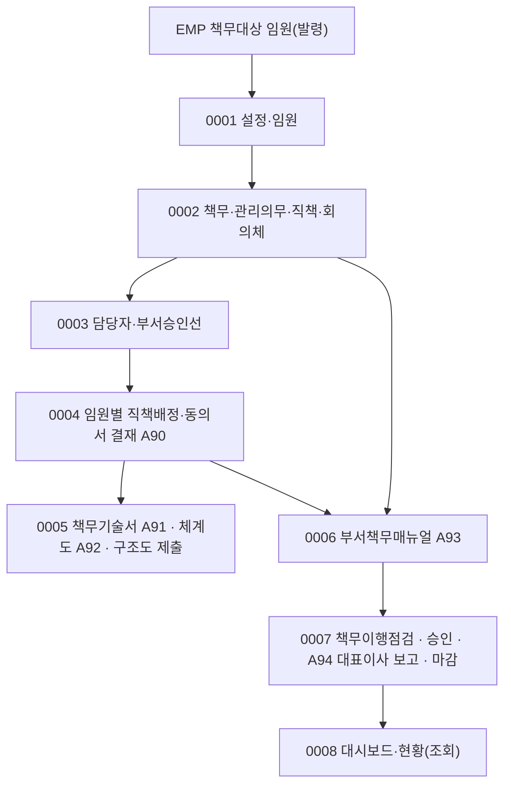

# TDM 업무흐름 — 책무구조도

TDM은 금융회사 지배구조법의 **책무구조도**(임원별 책무를 정하고 점검하는 제도)를 관리한다. 다른 도메인과 달리 **공통 마스터가 없고 회사가 책무·직책·임원을 직접 만든다**(운영 시작 때는 DB 함수 `ld_tdm_template`로 템플릿을 불러온다 — 아래 의심 #130). 큰 줄기는 ① 기초(설정·임원·책무·직책·회의체·담당자·승인선) → ② **책무구조도**(임원별 직책배정 → 책무기술서 → 책무체계도 → 이사회 제출) → ③ **부서책무매뉴얼**(작업대상 → 책무의무 생성 → 부서지정 → 점검항목 작성 → 부서 보고) → ④ **책무이행점검**(작업지시·부서점검·미흡 조치·대표이사 보고) → ⑤ 대시보드·현황이다. 임원 동의서·기술서·체계도·매뉴얼 보고는 전자결재(A90~A93)를 쓴다.

## 화면번호 → 이벤트

| 화면 | 이벤트 |
|:---|:---|
| #1411 임원 등록 | 0001 |
| #1412 책무 등록 · #1413 관리의무 등록 · #1415 회의체 등록 · #1414 직책별 책무 등록 | 0002 |
| #1454 책무담당자 등록 · #1463 직책별 부서승인선 등록 | 0003 |
| #1417 임원별 직책배정 | 0004 |
| #1418 임원별 책무기술서 · #1419 책무체계도 · #1480 책무구조도 제출 | 0005 |
| #1420 매뉴얼 작업대상 선정 · #1421 매뉴얼 부서지정 · #1422 매뉴얼(점검항목) 작성 | 0006 (#1423 부서별 보고·#1424 관리는 아직) |
| #1455 이행점검 작업지시 및 보고 · #1456 점검자 지정 · #1457 책무이행점검 · #1458 승인 · #1459 미흡 조치 | 0007 |
| #1495~#1497 대시보드 | 0008 (#1466~#1469·#1481 책무관리현황은 아직) |
